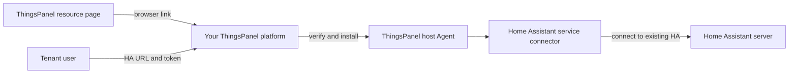

# Plugin Development, Release, and Installation

This guide explains the current ThingsPanel paths for device-access plugins, third-party service plugins, and notification plugins. These plugin types have different contracts and management screens. Registering a plugin in a platform does not automatically publish it in the public resource center.

> **Home Assistant scope:** The Home Assistant item described here is a **ThingsPanel third-party service connector**. It is not the Home Assistant website, an add-on installed inside Home Assistant, or a Home Assistant app-store integration. You must already have a Home Assistant server. The connector runs with ThingsPanel and connects to that existing server after a tenant enters its HA URL and token in ThingsPanel.



The user stays in ThingsPanel for installation and tenant configuration. The connector does not install or configure Home Assistant itself.

## 1. Choose the plugin type first

| Type | What it does | Platform management path | Public listing |
| --- | --- | --- | --- |
| Device-access protocol plugin | Connects devices using a protocol or protocol-specific service | The existing plugin-management page distinguishes protocol services (`service_type=1`) from service plugins (`service_type=2`). Follow the selected protocol plugin's own SDK and runtime contract. | Registration is not a public market listing. The current release path is reviewed and managed separately. |
| Third-party service plugin | Connects ThingsPanel to an external service, such as Home Assistant | Install the signed plugin catalog and artifact with the platform installer. A platform super administrator installs it; each tenant configures its own service access point afterward. | The current Home Assistant resource page is descriptive and links to an installer page. It is not an artifact repository or an author upload form. |
| Notification plugin | Adapts the notification core to an email, SMS, or messaging provider | Use the notification plugin contract. A system super administrator registers the plugin, manages provider accounts, and grants tenant access. | Publishing source code does not register or distribute the plugin in a ThingsPanel instance. See the [notification plugin guide](./notification-plugin.md) and [notification administration guide](../user-guide/system-admin-operation-manual/system-managment/notice_settings.md). |

The legacy [visual-plugin publishing guide](./developing-plug-in/visualPublishPlugin.md) is marked deprecated and incompatible with the current version. Do not use it as the release procedure for device-access, third-party service, or notification plugins.

## 2. What “publish to the market” means today

There are three separate operations:

1. **Build and release a plugin:** produce a versioned package or container image and its metadata.
2. **Register it in a ThingsPanel instance:** add a protocol/service plugin to the platform's plugin management, or register a notification plugin in its own catalog. Granting access and configuring credentials are separate operations.
3. **List it in the public resource center:** have the resource-center maintainer review and publish a page or item that points to the intended release and installation path.

ThingsPanel currently has no single author-facing upload flow that accepts all three plugin types and automatically performs these operations. A public source repository, an entry in the platform plugin list, and a public market listing are not interchangeable.

## 3. From plugin development to release: the current Home Assistant path

Release is more than pushing source code to GitHub. This section separates the source, signed artifacts, host update, platform installation, and resource-center listing. It describes the current published installer and plugin artifacts, then calls out the platform and clean-host checks that remain open.

### 3.1 Plugin developer: submit reproducible source

1. Implement the ThingsPanel plugin contract in the connector repository, including configuration fields, startup parameters, health checks, and relevant tests. The Home Assistant connector runs on the ThingsPanel host. A tenant enters the HA URL and credentials later in that tenant's ThingsPanel access point.
2. Pin dependencies to a published SDK version. Do not build public artifacts with a local `replace`, uncommitted files, or an unpublished SDK commit.
3. Submit and review the changes. Record the full connector source commit, semantic version, and SDK tag/commit. A public build must use these immutable revisions.

### 3.2 ThingsPanel release owner: build and sign candidate artifacts

The release artifacts were built by `.github/workflows/ha-plugin-candidate.yml`. An authorized release owner starts it manually in GitHub Actions and supplies the plugin version, full Home Assistant source commit, SDK tag, and full SDK commit. The workflow checks that the SDK tag resolves to that commit, that the connector checkout is clean, and that `go.mod` uses the published SDK. It then builds the Agent and connector image for `linux/amd64` and `linux/arm64`.

Each architecture's candidate contains the Agent binary, Docker image archive, catalog JSON, and signature. The catalog records the plugin/image version, immutable image ID, archive SHA-256, Agent SHA-256, target architecture, and source/SDK/installer commits. CI signs the catalog with the repository secret `TP_PLUGIN_CATALOG_SIGNING_KEY` and verifies it against the public key independently pinned in reviewed installer source. Never download, print, or place the private signing key in the connector repository, artifacts, public pages, or chat.

**Verified current state:** version `1.0.0` is available in the public plugin-only GitHub Release [`plugin-ha-v1.0.0`](https://github.com/ThingsPanel/thingspanel-installer/releases/tag/plugin-ha-v1.0.0). The matching signed `linux/amd64` and `linux/arm64` catalogs are public at `https://install.thingspanel.io/plugins/`; the catalog signatures, helper SHA-256 pins, and four Release asset digests were fetched from the public URLs and verified. The public installer Pages source is branch `codex/ha-plugin-public-site-20261108` at commit `72946f1`. This proves public, integrity-checked distribution; it does not prove installation on an arbitrary clean host or the complete platform Resource Center flow.

### 3.3 Installer maintainer: connect trusted delivery to install/upgrade

The public installer works as follows: the official install or upgrade flow first updates the reviewed updater. The updater downloads required helper scripts from the installer Pages site and checks them against SHA-256 pins embedded in updater source. Its trust root comes from reviewed installer code and is fixed independently from the catalog; users should not download a key from the catalog or type one in. The installer then fetches the current architecture-specific catalog from `https://install.thingspanel.io/plugins/catalog-linux-{amd64,arm64}.json` and its `.sig`, then downloads the catalog-selected Agent and HA image archive from the fixed ThingsPanel GitHub Release base.

The installer verifies the catalog signature, Agent/image archive digests, target architecture, and image ID before loading the image and starting the managed Agent. Clicking an install link in a browser does not transfer or execute these files. An existing host must first run a supported install/upgrade flow that includes the installer changes; opening a new web link alone does not update its Agent.

**Verified current state:** the public install/upgrade flow downloads the pinned helper scripts and architecture-specific signed catalog, then verifies the selected Agent and image archive. The `plugin-ha-v1.0.0` artifacts were staged from public URLs for both architectures and their digests matched the signed catalogs. An isolated runtime smoke using the public arm64 bundle passed Agent catalog, prepare, grant, activate, health, renew, and revoke calls. A full clean-host install/upgrade and platform UI acceptance remain pending; do not infer them from this smoke.

### 3.4 Platform super administrator, tenant, and resource-center maintainer

1. After the official installer update has deployed and started the Agent, a platform system super administrator (`SYS_ADMIN`) signs into ThingsPanel and opens `/apply/plugin?tab=install&plugin=homeassistant`. They select and install the connector from the Agent's verified catalog. No HA URL or token is entered here.
2. A tenant user signs into their tenant, opens **Device → Third-Party Integration** (`/device/integration`), creates their own HA service access point, and enters the HA URL and tenant-owned token. They then select entities using the existing flow. Plugin installation is platform-wide; access points and credentials are isolated by tenant.
3. The resource-center maintainer reviews and maintains the public descriptive page. It may link to an installation page on the user's chosen ThingsPanel instance, but that link is ordinary browser navigation. It does not carry the image, bypass sign-in or `SYS_ADMIN` authorization, or install/upgrade the Agent on the server.

A successful browser redirect, Actions artifact, or resource-center page alone does not prove a formal plugin release. The fixed source commit, signed catalog, public-key fingerprint, Agent/image digests, permanent download location, usable installer version, and actual installation result must all refer to the same release and pass acceptance before it is announced publicly.

## 4. Home Assistant installation and tenant setup

The current intended roles are:

1. After the host has completed a supported install/upgrade flow that includes the official installer update, and the architecture-matched trusted catalog, image, and Agent are available, a platform **system super administrator (`SYS_ADMIN`)** signs into that ThingsPanel instance, opens the plugin installation page, and installs Home Assistant. Installation does not ask for a Home Assistant URL or token. A tenant user cannot perform this platform installation. Opening the resource link alone does not update an older host's Agent.
2. A tenant user signs into that tenant and opens **Device → Third-Party Integration** (`/device/integration`). The tenant creates its own Home Assistant access point and enters the reachable HA base URL and its own long-lived access token there.
3. The tenant selects the entities it needs and completes the existing device onboarding flow. Credentials belong to that tenant's access-point configuration and must not be placed in the public plugin package, R page, logs, or documentation.

The plugin process being healthy does not prove that a tenant's HA URL or token works. Keep plugin health and each tenant access point's connection state distinct.

## 5. How the resource-center button works

A link such as:

```text
https://<reachable-ThingsPanel-host>/apply/plugin?tab=install&plugin=homeassistant
```

is ordinary browser navigation to the specified ThingsPanel host. The `tab=install` query selects the install tab, and `plugin=homeassistant` asks the install page to select and open that plugin when it appears in the host's catalog. The page requires sign-in, and the installation action requires platform `SYS_ADMIN`. The host must already run a supported installer version with its reviewed trust-root pin and have the architecture-matched signed catalog, image, and Agent available. The platform and its Agent then perform authorization, signature checks, and installation.

The link itself does not transfer a plugin image, grant platform permissions, update the host Agent, or install anything. A link to `127.0.0.1` or `localhost` points to the computer running the browser. That is useful only when ThingsPanel is running on that same computer. For a public listing, use the intended reachable platform/install flow; do not publish a developer's loopback URL as a universal installer.

## 6. Current Home Assistant release status

The [Home Assistant Resource Center page](https://r.thingspanel.cn/marketplace/plugins/homeassistant) is a public description and installer deep link for the ThingsPanel third-party service plugin. It is not a Home Assistant app or an installer that runs on the visitor's computer. Its current public copy accurately says that users enter their own ThingsPanel platform address and sign in as that platform's super administrator.

**Public distribution is available:** plugin version `1.0.0` is published as the plugin-only GitHub Release [`plugin-ha-v1.0.0`](https://github.com/ThingsPanel/thingspanel-installer/releases/tag/plugin-ha-v1.0.0), with signed catalogs and architecture-matched assets for Linux amd64 and arm64. Public catalog signatures, helper pins, artifact digests, public URL staging, and an isolated arm64 runtime lifecycle smoke have been verified.

**Acceptance still open:** no clean new ThingsPanel installation was completed; the live Resource Center to real platform installation flow was not exercised; no production platform backend or Home Assistant endpoint was connected. Device telemetry, commands, and tenant HA connectivity are outside the completed smoke. Do not call those scenarios verified or require them as a prerequisite for starting the planned manual installation test.

For manual testing, record the ThingsPanel revision and installer/Agent version, host architecture, whether the test is a clean install or upgrade, platform super-administrator install result, plugin health, and tenant access-point result as separate observations. Keep tenant HA credentials out of screenshots and logs. A healthy plugin alone does not prove a tenant connection.
