# Matter

The Matter connector lets ThingsPanel discover, bind, monitor and control **Matter** lights (On/Off and dimmable) that are on your local IP network. It is a *Third-party Access* connector: you install it once, create an access point, and import the devices you want.

:::caution Status: candidate
The connector has been tested end to end against the connectedhomeip lighting **simulator** only (install, discovery, binding, telemetry, commands, tenant isolation). It has **not** been verified with real Matter hardware, Thread devices, real-LAN multicast, power-loss recovery or long-running stability. Use it for evaluation, not production.
:::

The screenshots show the Chinese interface. Menu and button names are given in English with the Chinese label in parentheses.

## 1. Overview

- **Discover**: lists the Matter nodes that have been paired to the gateway runtime (see below) and shows each On/Off or dimmable endpoint.
- **Report**: Matter attribute reports become telemetry (`power`, `brightness_pct`); reachability becomes online/offline.
- **Control**: `set_power` and `set_brightness` commands from ThingsPanel are sent to the device.
- **Scope**: lights that support the On/Off cluster, optionally with Level Control. No Thread support, no sensors, locks or thermostats.

## 2. How it works

```
Matter devices (your LAN, IPv6 + mDNS)
        ▲
Matter gateway runtime   ← run by you, outside the Agent (needs LAN access; owns the Matter "fabric" data)
        ▲  TCP :7001, shared token (keep on a private network)
Matter connector         ← installed from Plugin management (runs under the Agent)
        ▲
ThingsPanel platform + MQTT broker
```

The connector is deliberately small. Everything that needs the LAN (device discovery, pairing, the Matter fabric credentials) lives in the **gateway runtime**, which you run yourself. The Agent only manages the connector.

## 3. Prerequisites

- A ThingsPanel platform with **plugin installation** (managed runtime identity) and a signed plugin catalog that contains the Matter connector. Your administrator provides this.
- A Linux host on the **same IP network (and IPv6/mDNS multicast domain)** as the Matter devices, with Docker. On Docker Desktop for Mac/Windows containers cannot join the LAN multicast domain, so use Linux for real devices.
- A persistent Docker volume for the gateway runtime. It holds the Matter fabric (the keys that let ThingsPanel control your devices). Back it up and never share it.
- Devices that are Matter on-network capable (Wi-Fi/Ethernet). Thread devices are not supported.

## 4. Run the gateway runtime

Generate a shared token (at least 32 characters) and start the gateway runtime on the LAN host:

```bash
openssl rand -hex 32          # keep this value; it is the connector's token

docker run -d --name matter-gateway --restart unless-stopped \
  --network host \
  -v matter-gateway-data:/var/lib/thingspanel-matter \
  --tmpfs /tmp:rw,nosuid,nodev,size=64m \
  -e MATTER_CONTROLLER_TOKEN=<token> \
  thingspanel-matter-gateway:<version>
```

Notes:

- The gateway image is built from the Matter connector repository (`connector/Dockerfile.gateway`); ask your administrator for the image and version.
- The endpoint listens on port `7001` and uses **plain TCP**. The pairing code is sent over it, so keep it on a private network and allow only the connector's host to reach it.
- The connector must be able to reach `<gateway host>:7001`. Your administrator sets that address in the Matter catalog entry.

## 5. Install the connector

This step is done by a platform administrator.

1. Open **Application Management → Plugin Management (应用管理 → 插件管理)** and select the **Plugin Installation (插件安装)** tab.
2. Find **Matter** and click **Install (安装)**. The card name and version come from your catalog entry.
3. Enter the gateway token (`MATTER_CONTROLLER_TOKEN`) from step 4. The value is stored by the Agent and shown afterwards only as *set*.

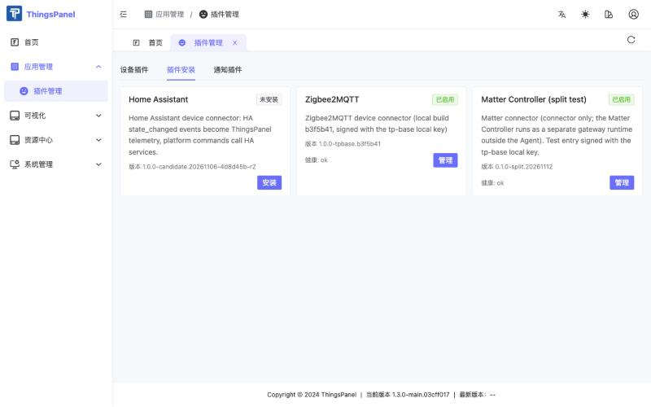

After a short time the card shows **Enabled (已启用)**. Click **Manage (管理)** to see the install steps and health.

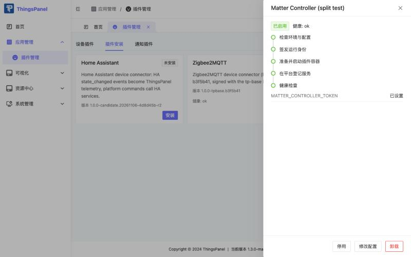

## 6. Pair a light with the gateway

Pairing is done on the gateway host, not in ThingsPanel. Put the light in pairing mode (or open a commissioning window from the vendor app), then:

```bash
docker exec -it matter-gateway /connector matterctl commission --timeout-seconds 30
```

The command asks for the setup PIN without echoing it. It is sent once to the local controller and is never logged or stored. Check the result:

```bash
docker exec matter-gateway /connector matterctl list
```

Each paired On/Off or dimmable endpoint is listed with its node id and endpoint. To remove a node from the Matter fabric (unbinding in ThingsPanel does **not** do this):

```bash
docker exec matter-gateway /connector matterctl remove --node-id <node-id> --confirm
```

## 7. Create a thing model and a device template

ThingsPanel sends commands that are defined by a **thing model**. Do this once per tenant.

### 7.1 Thing model

1. Open **Device Access → Thing Models (设备接入 → 物模型)** and click **New thing model (新建物模型)**. Enter a name (for example `Matter Dimmable Light`) and a version. Save.

   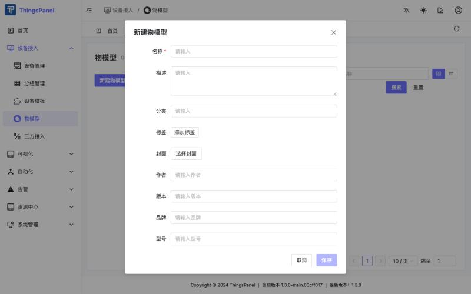

2. Open the **Thing model definition (物模型定义)** tab. Under **Telemetry (遥测)** add two fields:

   | Name | Identifier | Data type |
   |---|---|---|
   | Power | `power` | Boolean |
   | Brightness | `brightness_pct` | Number |

   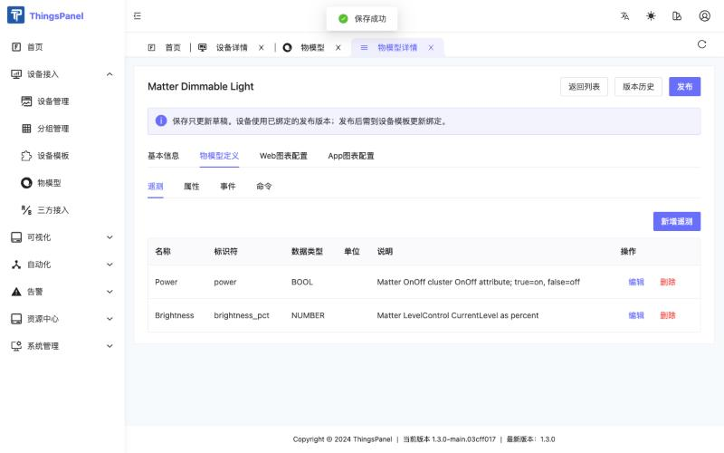

3. Under **Commands (命令)** add two commands, each with one parameter:

   | Name | Identifier | Parameter | Type |
   |---|---|---|---|
   | Set power | `set_power` | `value` | Boolean (true = on) |
   | Set brightness | `set_brightness` | `value` | Number (0–100) |

   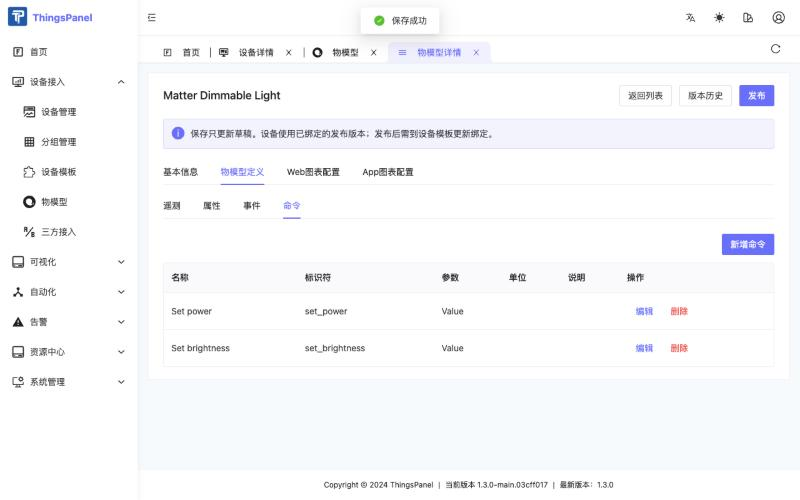

4. Click **Publish (发布)**. A published version is what devices use; editing the draft later does not change devices until you bind the new version.

   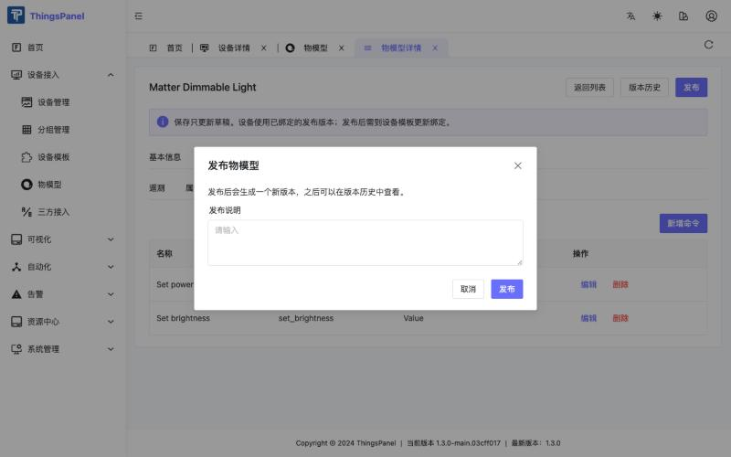

### 7.2 Device template

The discovery dialog offers a **Device template (设备模板)** per device. Create one for the Matter connector, using the script from the connector repository (it calls the same API the UI uses):

```bash
TOKEN=$(curl -s -X POST https://<platform>/api/v1/login -H 'content-type: application/json' \
  -d '{"email":"<tenant user>","password":"<password>"}' | jq -r .data.token)

TP_BASE_URL=https://<platform> TP_TOKEN=$TOKEN \
  scripts/create-matter-template.py templates/dimmable-light.json --config-only --protocol-type matter
```

Then open **Device Access → Device Templates (设备接入 → 设备模板)**, open the new **Matter Dimmable Light** template, go to the **Thing model (物模型)** tab, choose your thing model and its published version, and click **Save (保存)**.

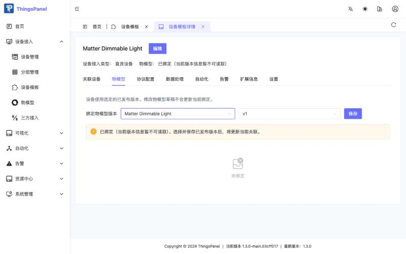

:::note
`--protocol-type` is the service identifier of the installed connector (`matter` unless your administrator chose another one).
:::

## 8. Create an access point and bind devices

1. Open **Device Access → Third-party Access (设备接入 → 三方接入)** and click the **Matter** card.

   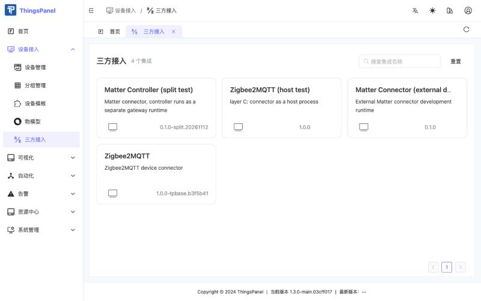

2. Click **New access point (新建接入)**. Enter a name and keep the mode **Manual (手动)**. The Matter connector needs no other settings. Click **Save and next (保存并下一步)**.

   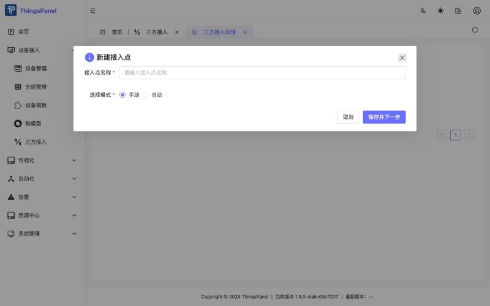

   Use **one access point per gateway runtime**: a gateway is tied to the first access point (and tenant) that uses it.

3. The dialog lists the devices found by the gateway.

   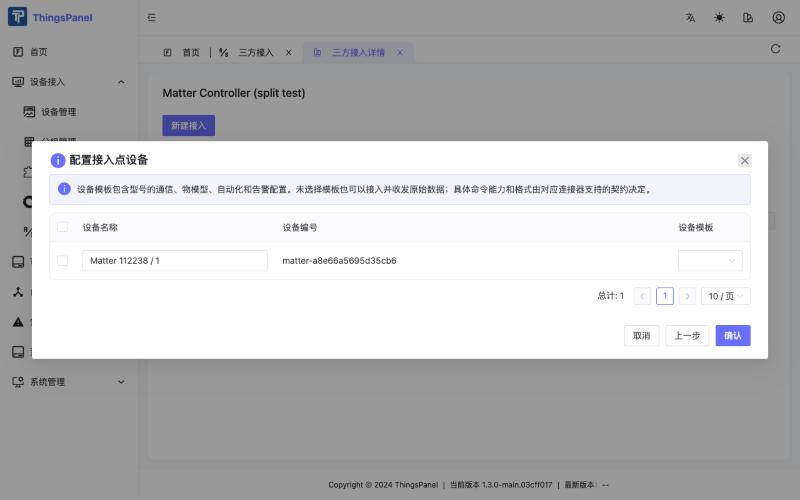

   Tick the device, choose the **Device template (设备模板)** from section 7, and click **Confirm (确认)**.

   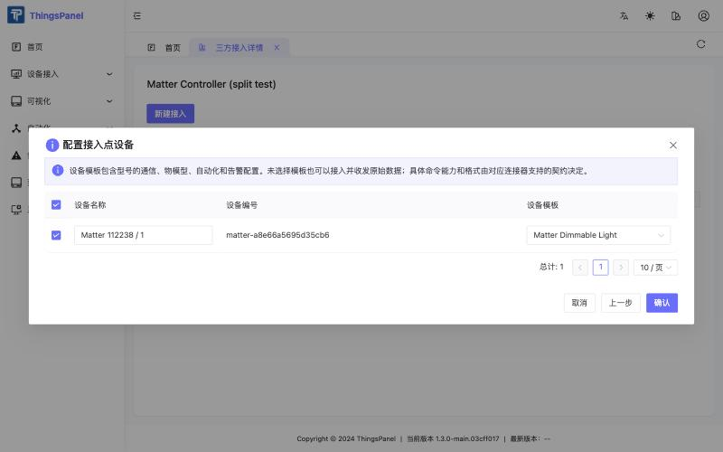

   :::caution
   If you click **Confirm** without a ticked device, ThingsPanel only shows "Access point configuration saved" and binds nothing. Tick the device first.
   :::

4. The access point list now contains your access point. **View devices (查看设备)** opens the device list; **Edit configuration (修改配置)** reopens the dialog to bind more devices.

   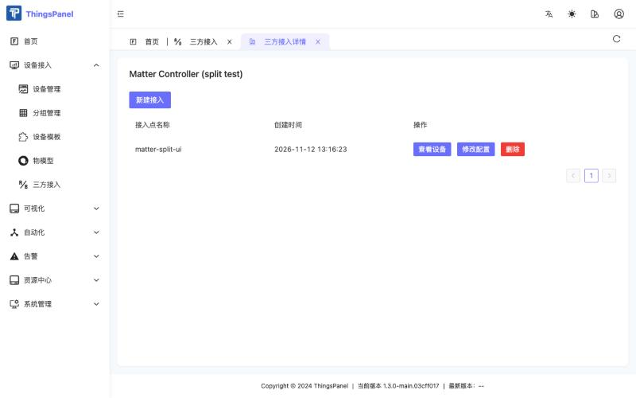

A newly bound device is picked up within about two minutes and then shows online. If it stays offline, ask your administrator to refresh the broker device scope.

## 9. Monitor and control

Open **Device Access → Device Management (设备接入 → 设备管理)**.

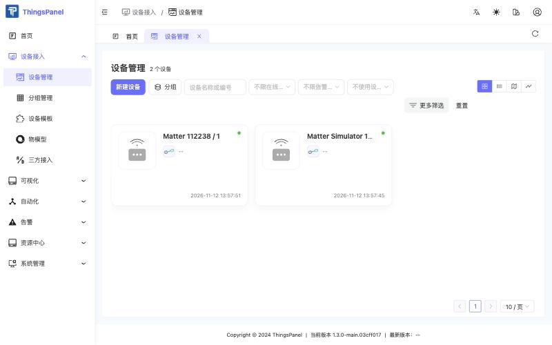

Open the device. The **Telemetry (遥测)** tab shows `power` and `brightness_pct`.

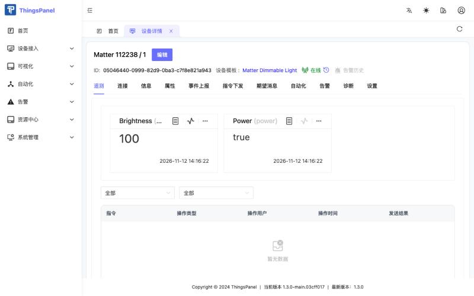

Open the **Commands (指令下发)** tab, click **Send command (下发命令)**, choose `Set power` or `Set brightness`, set **Value**, and click **Send (下发)**.

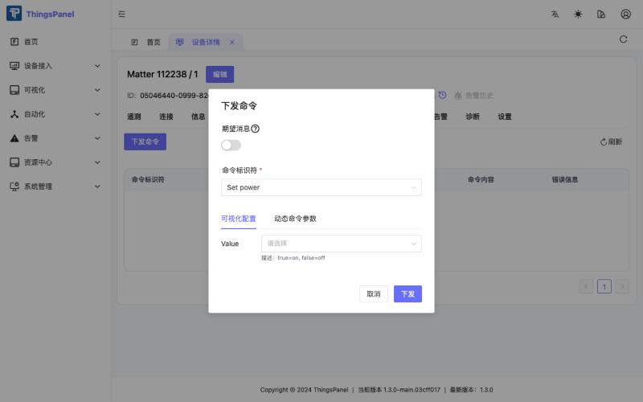

The command list shows the result. "Returned success" means the Matter controller accepted the command; the new state then arrives as telemetry.

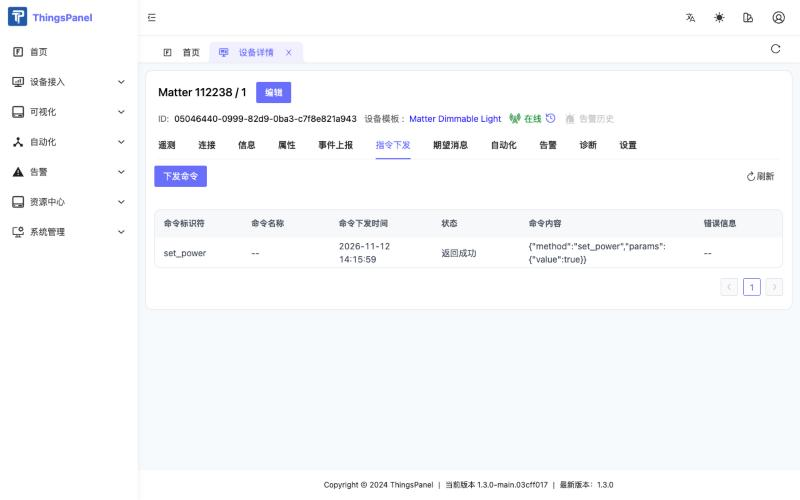

### Telemetry and commands

| Item | Identifier | Value |
|---|---|---|
| Telemetry | `power` | `true` / `false` |
| Telemetry | `brightness_pct` | integer 0–100 (mapped to Matter level 1–254) |
| Command | `set_power` | `{"value": true}` or `{"value": false}` |
| Command | `set_brightness` | `{"value": 0..100}` |

You can also send commands through the platform API (`POST /api/v1/command/datas/pub`) with the same identifiers and values.

## 10. Known limitations and FAQ

**The device list is empty although the binding succeeded.** In platform builds whose front end lists devices from the new device store only (`/api/v2/devices`), devices bound through Third-party Access are not shown yet. They exist and work (telemetry, commands, templates); open them from the template's **Associated devices (关联设备)** tab, or use the released v1.3.0 front end. This is a platform limitation, not a Matter issue; Zigbee2MQTT and other Third-party Access connectors are affected in the same way.

**The command dialog has no commands.** The device template is not bound to a published thing model version. See section 7 and the warning shown in the dialog.

**The device stays offline after binding.** Wait up to two minutes for the connector's status refresh. The platform's broker device scope must include the new device; ask your administrator to refresh it if it does not.

**A brightness change shows up late.** The simulator reported level changes up to about 40 seconds later in our tests; check the real latency with your device.

**Unbinding a device does not remove it from the Matter fabric.** Use `matterctl remove` on the gateway host.

**Several access points.** A gateway runtime serves exactly one access point. Run another gateway runtime (and another connector instance) for another tenant or site.

**Security.** The gateway token and the fabric volume give control over your devices. Keep the endpoint on a private network, do not publish the token, and never put development or simulator trust roots into a production gateway.

For build instructions, the architecture and the test record see the Matter connector repository.
