# Zigbee2MQTT

The Zigbee2MQTT connector brings Zigbee devices managed by [Zigbee2MQTT](https://www.zigbee2mqtt.io/) (Z2M) into ThingsPanel. After reading this guide you can install the connector, discover the devices Z2M has paired, bind them in bulk, watch their telemetry and send commands such as on/off and brightness.

The screenshots show the Chinese interface. Menu and button names are given in English with the Chinese label in parentheses. Steps are marked **Administrator** (platform administrator) or **Tenant user**.

## 1. Overview

- **Discover**: the connector reads Z2M's retained `bridge/devices` list and shows the paired devices in ThingsPanel for bulk binding.
- **Report**: device state (temperature, humidity, on/off, brightness, …) becomes telemetry. If Z2M availability is on, online/offline is reported too.
- **Control**: switch and brightness commands, and any writable property the device exposes, are sent to Z2M and confirmed by reading the device state back.
- Devices are identified by their IEEE address, so renaming a device in Z2M does not break its binding.
- **Scope**: devices that Zigbee2MQTT exposes over MQTT — lights (on/off, brightness), plugs and switches, and numeric sensors such as temperature and humidity. Documented with ThingsPanel v1.3.0.

## 2. How it works

```
Zigbee devices ── Zigbee2MQTT ── MQTT broker ◀── Zigbee2MQTT connector ──▶ ThingsPanel
   (radio)        (you run it)    (you run it)    (plugin, run by the platform)
```

You run Zigbee2MQTT and its MQTT broker. The connector is a plugin that the platform administrator installs; it connects to your Z2M broker using the address you enter in an access point, so no Zigbee2MQTT plugin and no Home Assistant integration is needed.

## 3. Prerequisites

- A ThingsPanel platform that supports plugin installation, with the Zigbee2MQTT plugin available in its plugin catalog.
- A Zigbee coordinator (USB dongle) attached to the machine that runs Z2M.
- An MQTT broker reachable by both Z2M and the platform's plugin runtime.
- Z2M's Home Assistant integration switched **off**.

## 4. Deploy Zigbee2MQTT

The following `docker-compose.yml` runs Mosquitto and Zigbee2MQTT. Replace the device path with your coordinator's (`/dev/ttyUSB0` is only an example).

```yaml
services:
  mosquitto:
    image: eclipse-mosquitto:2
    restart: unless-stopped
    ports:
      - "1883:1883"
    volumes:
      - ./mosquitto/config:/mosquitto/config
      - ./mosquitto/data:/mosquitto/data

  zigbee2mqtt:
    image: koenkk/zigbee2mqtt
    restart: unless-stopped
    depends_on:
      - mosquitto
    ports:
      - "8080:8080"          # Z2M web UI
    volumes:
      - ./z2m-data:/app/data
    devices:
      - /dev/ttyUSB0:/dev/ttyUSB0
```

`mosquitto/config/mosquitto.conf`:

```conf
persistence true
persistence_location /mosquitto/data/
listener 1883
allow_anonymous false
password_file /mosquitto/config/passwords
```

Create the password file with `mosquitto_passwd -c mosquitto/config/passwords <user>`. Then `z2m-data/configuration.yaml`:

```yaml
homeassistant: false
permit_join: false
mqtt:
  base_topic: zigbee2mqtt
  server: mqtt://mosquitto:1883
  user: <mqtt user>
  password: <mqtt password>
serial:
  port: /dev/ttyUSB0
frontend:
  port: 8080
availability: true
```

:::caution
Do not add or copy a `network_key` or `pan_id` by hand: Z2M generates them on first start. Never publish or share your `configuration.yaml`, it contains your Zigbee network key.
:::

`availability: true` lets Z2M report when a device goes offline; without it ThingsPanel only learns that a device is online when it sends data and never marks it offline. Expose the broker only to networks you trust and keep authentication on. Start the stack with `docker compose up -d`.

## 5. Install the connector (Administrator)

1. Open **Application Management (应用管理)** → **Plugin Management (插件管理)** and switch to the **Plugin Installation (插件安装)** tab.
2. Find the **Zigbee2MQTT** card. Once installed, it shows **已启用** (enabled) and `健康: ok` (health: ok).

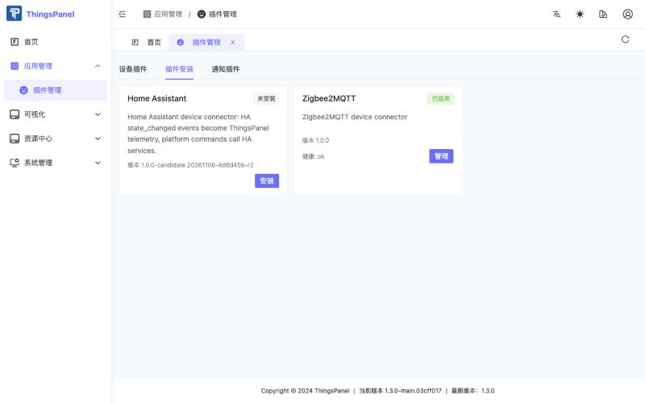

An installed connector appears for tenant users under **Device Access (设备接入)** → **Third-party Access (三方接入)** as the **Zigbee2MQTT** integration.

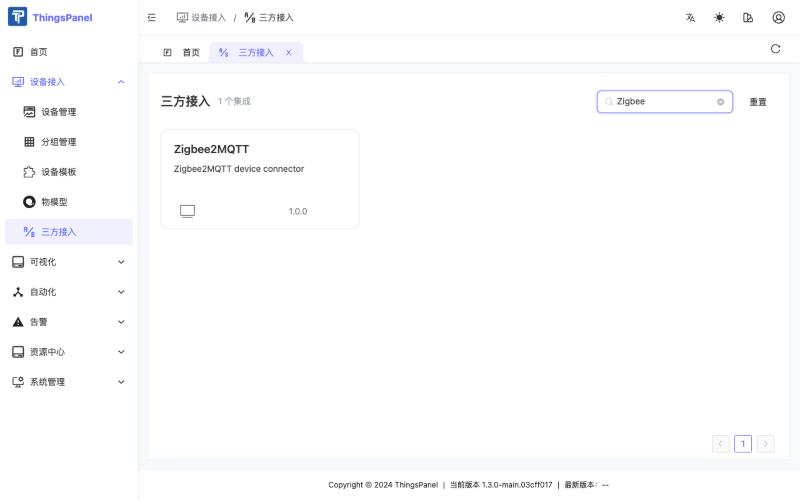

## 6. Pair devices in Zigbee2MQTT

Pairing is done in Zigbee2MQTT, not in ThingsPanel:

1. Open the Z2M web UI and click **Permit join (All)**, or temporarily set `permit_join: true`.
2. Put the device in pairing mode (usually by pressing its reset button for several seconds).
3. Wait until Z2M shows the device as interviewed, then turn permit join off again.

## 7. Create a thing model and a device template (Tenant user)

Commands come from a **published thing model**. Telemetry is stored without one, but a thing model gives the values names and units, and the device template links the model to the devices.

### 7.1 Create the thing model

1. Open **Device Access (设备接入)** → **Thing Model (物模型)** and click **New Thing Model (新建物模型)**. Enter a name, for example `Zigbee Light`, and save.

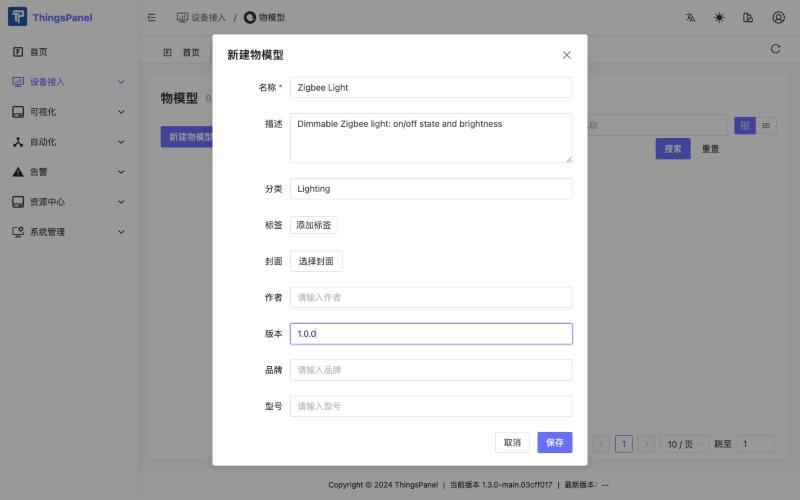

2. In **Thing Model Definition (物模型定义)** → **Telemetry (遥测)** click **Add Telemetry (新增遥测)**. The identifier must equal the Z2M property name.

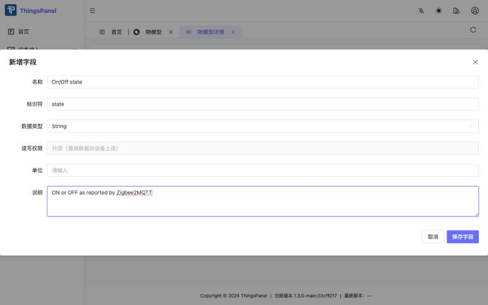

3. In the **Command (命令)** tab click **Add Command (新增命令)** and add one parameter for each command.

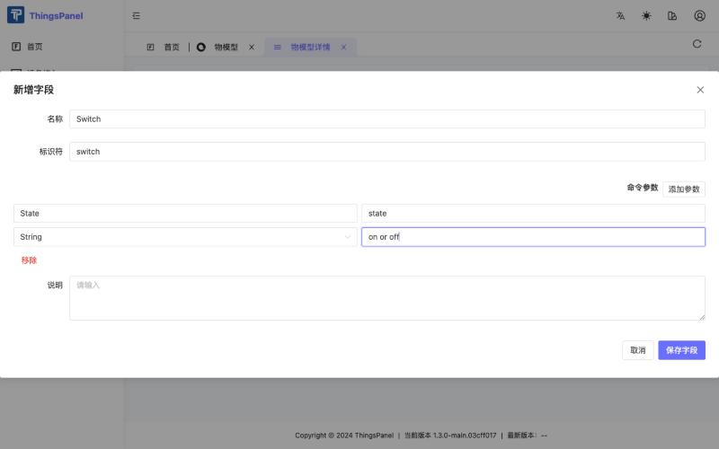

Suggested fields:

| Device | Telemetry identifiers | Command identifier (parameter) |
|---|---|---|
| Light | `state` (String), `brightness` (Number, 0–254) | `switch` (`state`: on / off), `set_brightness` (`level`: 1–100) |
| Temperature/humidity sensor | `temperature` (Number), `humidity` (Number) | none |

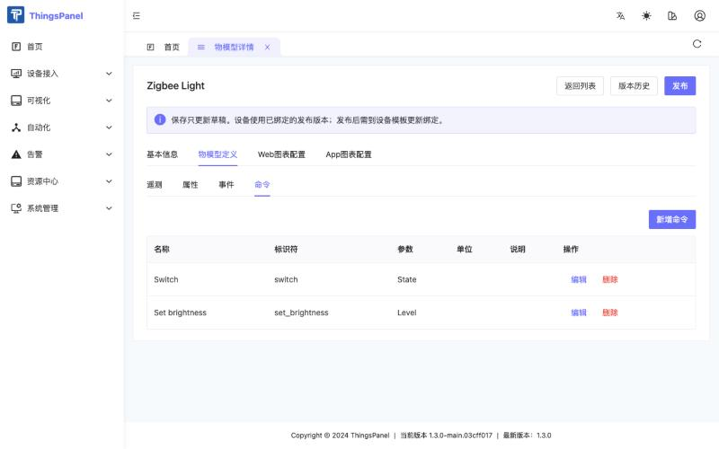

:::caution
The platform does not accept a command whose identifier equals a telemetry identifier in the same thing model. That is why the brightness command is named `set_brightness` while the telemetry is `brightness`. The connector accepts `set_<name>` for every command name.
:::

4. Click **Publish (发布)**, enter a release note and confirm. A thing model can only be used after it is published.

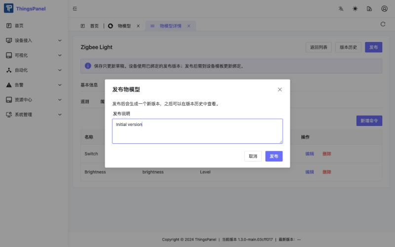

### 7.2 Create the device template

1. Open **Device Template (设备模板)** and click **New Device Template (新建设备模板)**. Enter a name, choose **直连设备** (direct device) as the access type, and select the **Zigbee2MQTT** service under **选择协议/服务**. Confirm with **OK (确定)**.

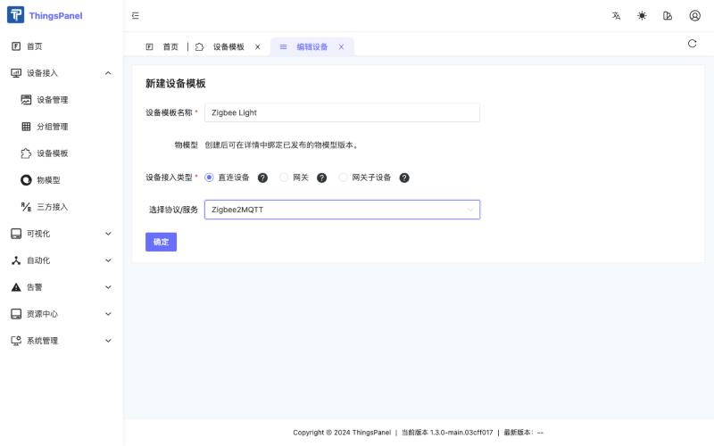

2. Open the template, switch to its **Thing Model (物模型)** tab, choose the published thing model and version, and click **Save (保存)**. When you publish a new version of the thing model, select the new version here again.

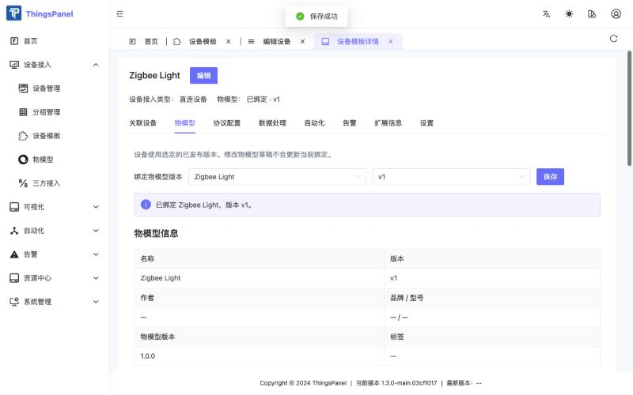

## 8. Create an access point and bind devices (Tenant user)

1. Open **Device Access (设备接入)** → **Third-party Access (三方接入)** → **Zigbee2MQTT**.

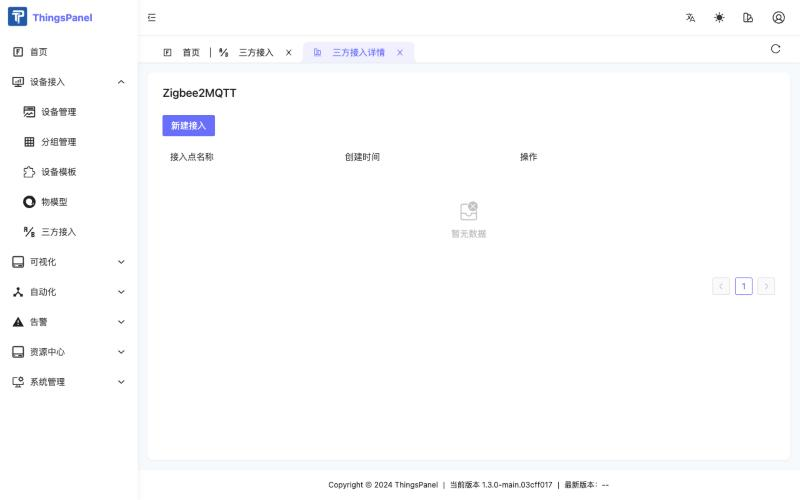

2. Click **New Access (新建接入)** and fill in the form.

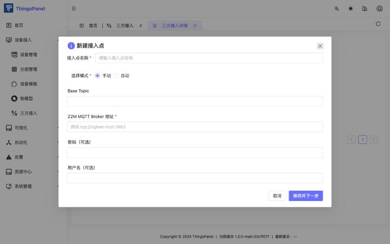

| Field | Description |
|---|---|
| 接入点名称 | Any name |
| 选择模式 | Keep **手动** (manual) |
| Base Topic | Z2M `base_topic`, default `zigbee2mqtt` |
| Z2M MQTT Broker 地址 | Broker that Z2M publishes to, for example `tcp://<broker-host>:1883`; it must be reachable from the platform |
| 用户名 / 密码（可选） | Broker credentials, if required |

Each access point opens its own connection to its Z2M broker; create one access point per Z2M instance.

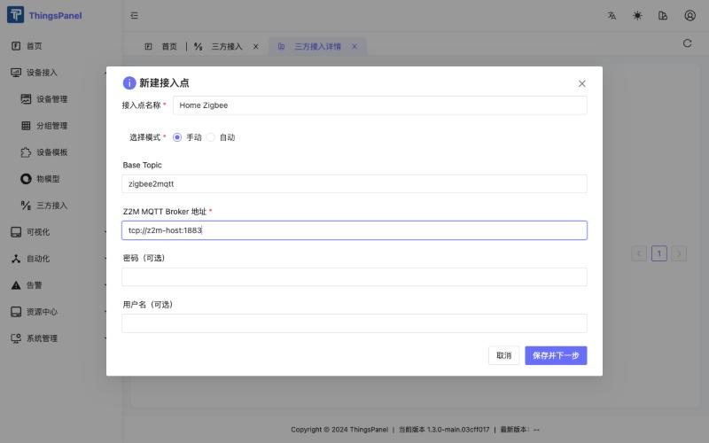

3. Click **Save and Next (保存并下一步)**. The connector lists the devices Z2M has paired and interviewed (the coordinator, unsupported and disabled devices are not listed). The next time you open the access point, use **Modify Configuration (修改配置)** → **保存并下一步** to return to this list.

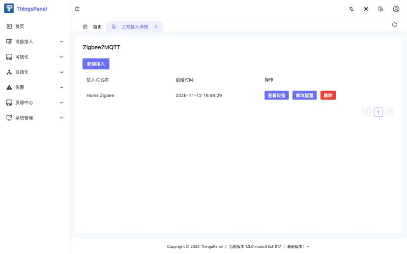

4. **Tick the devices you want to bind first**, choose the device template for each (the light uses `Zigbee Light`), then click **Confirm (确认)**. Without ticking a device, nothing is bound.

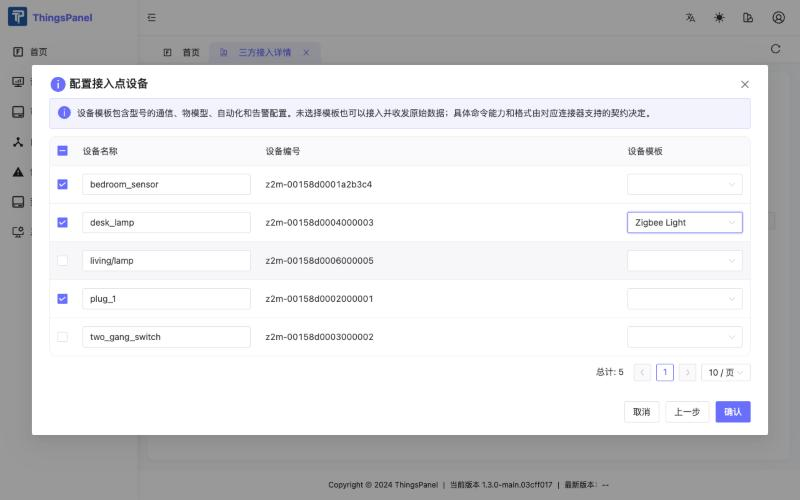

A device bound without a template still reports raw data, but commands need a template with a published thing model.

## 9. Monitor and control (Tenant user)

1. Open **Device Access (设备接入)** → **Device Management (设备管理)**. The connector picks up new bindings within about 30 seconds; devices usually turn online (green dot) within about a minute and can take up to two minutes.

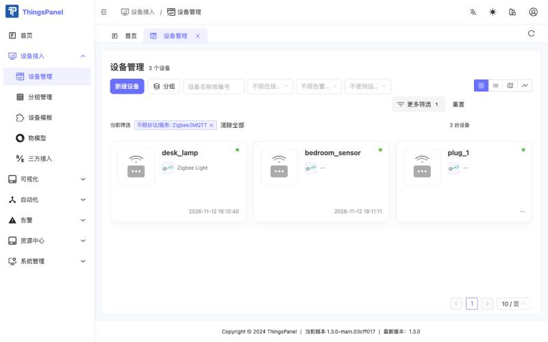

2. Open a device and stay on the **Telemetry (遥测)** tab. Values are named after the thing model; keys that are not in the model are shown as "绑定版本未定义" (not defined in the bound version), for example `linkquality`.

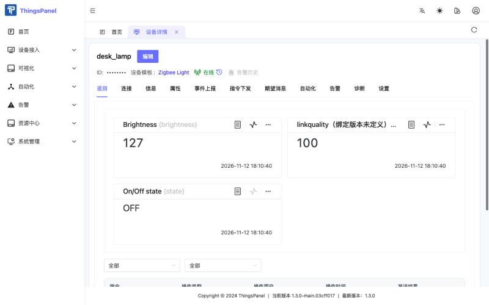

Telemetry keys are Z2M's own property names, flattened one level (`color.x` becomes `color_x`); `update`, `update_available` and `last_seen` are dropped; `ON`/`OFF` stay strings.

3. Open the **Command Dispatch (指令下发)** tab, click **Send Command (下发命令)**, choose the command and fill in its parameter.

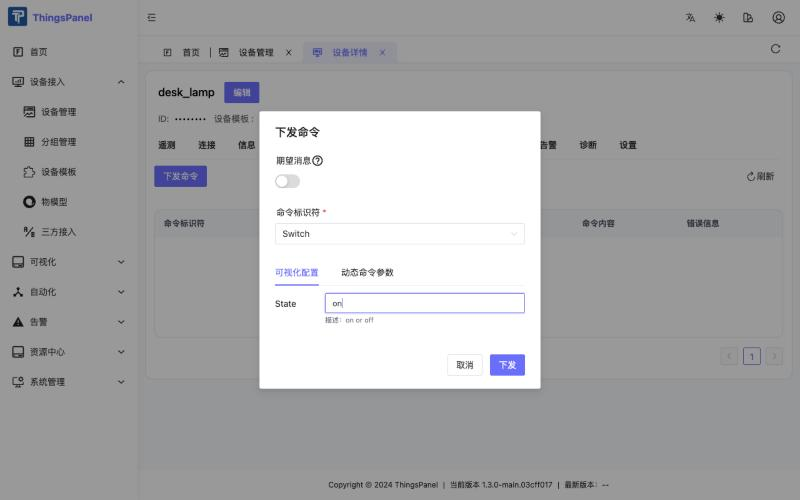

| Command | Parameter value | Sent to Z2M |
|---|---|---|
| `switch` | `on`, `off`, `true`, `false`, `1`, `0` | `{"state":"ON"}` or `{"state":"OFF"}` (several switches on one device: use the property name as the command, for example `state_l2`) |
| `set_brightness` (or `brightness`) | 1–100 (%) | `{"brightness": <0–254>}`; 50 % was sent as 127 |
| any writable property the device exposes | value | `{"<property>": value}` |

A command is shown as **返回成功** (succeeded) only when the device's next state matches what was sent; the connector waits up to 5 seconds. Commands for properties the device does not expose, or that are read-only, fail with a message in the error column; battery devices that sleep may answer too late and show a failure.

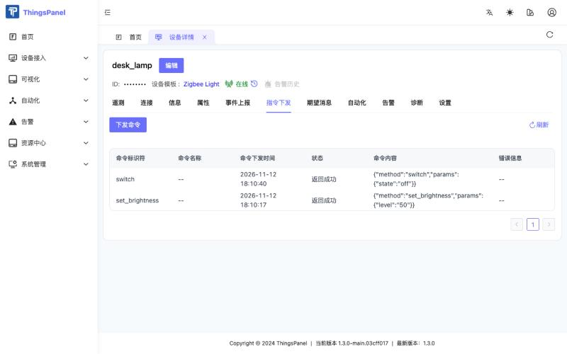

## 10. Known limitations and FAQ

:::note
In ThingsPanel frontends that read only the new device API, devices bound through third-party access may not appear in the device list. They exist and work; open them from the **关联设备** (associated devices) tab of their device template.
:::

- **Commands are rejected before sending.** The device was bound without a template, the template has no published thing model version bound, or the command identifier equals a telemetry identifier. Fix it as described in section 7.
- **A device shows online data but stays offline.** Turn on `availability: true` in Z2M; without it a device is marked online when it sends data and never offline.
- **The access point shows no devices.** Z2M must be running and publishing `bridge/devices` (retained). Check the broker address, credentials and base topic; the connector waits up to 3 seconds for the message.
- **A device does not report after binding.** Wait up to two minutes; check that the device sent data after binding.
- **Renaming a device in Z2M** does not break the binding: bindings use the IEEE address.
- **Many devices.** Every bound device uses one MQTT connection to the ThingsPanel broker; hundreds of devices mean hundreds of connections.
- **Device models differ.** Commands are accepted for the properties a device exposes as writable; check the device's **Exposes** tab in the Z2M web UI before defining commands.
- Not included: Zigbee pairing control (`permit_join`), OTA updates, groups and scenes, and automatic creation of thing models.
