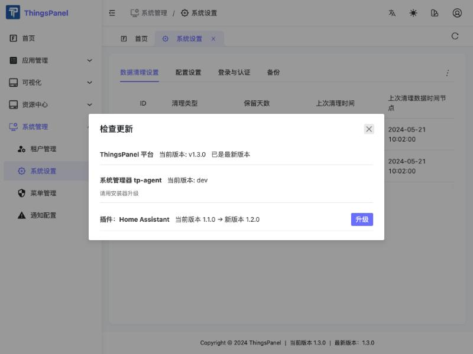
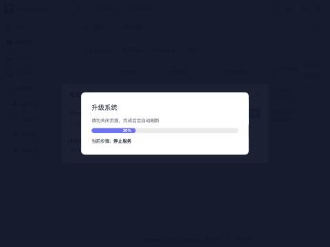
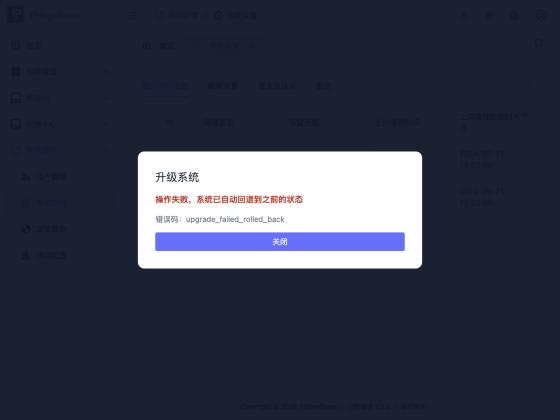

# System Operations: Restart, Backup, Restore and Upgrade

> Visible to super administrators (system admins) only. The entry point is **System Management → System Settings**.

ThingsPanel provides a set of operations features in System Settings, so you can do the following without logging in to the server or typing commands:

- **Check for updates**: new versions of the platform, the system manager (tp-agent) and installed plugins appear in one list, where you can upgrade them;
- **Restart system**: the configuration is checked first, and a restart is refused if the configuration is invalid;
- **Backup and restore**: create a backup at any time, and restore the system to any backup;
- **Safe upgrade**: a backup is taken automatically before every upgrade, and if the new version fails to start, the system **rolls back automatically** to the previous version and data.

:::info Scope
These features are provided by the system manager (tp-agent) deployed by the official installer. They require an environment installed or upgraded with the official installer. A manual source-code deployment has no system manager, and the related actions report that they are unavailable.
:::

## Entry points

Open **System Management → System Settings** and click the **⋮** menu at the top right of the page:

| Menu item | What it does |
|---|---|
| Check for updates | Lists available updates and lets you upgrade directly |
| Restart system | Opens the restart dialog |

**Backups** are in the "Backup" tab of the System Settings page.

## Check for updates and upgrade

Click **Check for updates**. The list shows three kinds of items:

| Item | Description |
|---|---|
| ThingsPanel platform | Shows the new version and an "Upgrade" button when one is available, or "up to date" otherwise |
| System manager tp-agent | Shows the version only. It cannot be upgraded from the UI; use the installer |
| Plugins (for example Home Assistant) | Shows "current version → new version" and an "Upgrade" button when one is available |

### Upgrade the platform

1. Click **Upgrade** on the platform row and confirm.
2. The system **takes a backup automatically first** (this cannot be skipped).
3. The page switches to a maintenance page showing the current step and progress. **Do not close the page**; it refreshes by itself when the upgrade finishes.
4. When the upgrade completes, the footer shows the new version number. Your data, devices and accounts are unchanged.

**What if the upgrade fails?** If a migration of the new version fails, or the health check fails after startup, the system **rolls back automatically** to the previous version and data, and shows that the operation failed and the system was rolled back to its previous state. You do not need to do anything to recover.

:::note How long does it take
A normal upgrade usually takes about a minute. If the new version never becomes healthy, the system waits up to about 5 minutes before rolling back, so a failed upgrade can take close to 7 minutes in the worst case. Please be patient.
:::

:::caution Data during an upgrade
The platform stops serving briefly during an upgrade or rollback, and device data reported in that window may be lost. Choose a quiet period for upgrades.
:::

### Upgrade a plugin

Click **Upgrade** on the plugin row and confirm. The system installs the new plugin version and only records it as the current version once it is healthy. The plugin's site configuration and secrets are kept.

- If the image for the new version is not available on the host, the upgrade is refused and the running plugin is **not affected**.
- If a plugin upgrade fails, it does **not** automatically roll back to the old version at present. The plugin stays in a failed state and you can retry the upgrade.

## Restart system

Click **⋮ → Restart system**. When the dialog opens, the system first **checks the configuration**:

- If the check passes, you can choose the restart scope.
- If the check fails, the faulty items are shown, the **Restart button is disabled**, and nothing is changed.

| Scope | Effect | Duration |
|---|---|---|
| **Restart platform services** (recommended, default) | Restarts only the platform back-end services. **Devices stay connected** | About 40 seconds |
| **Full-stack restart** | Also restarts the messaging service (MQTT broker). Devices disconnect briefly and reconnect automatically | About 10 seconds of disconnection, then reconnect |

A maintenance page with progress is shown during the restart, and the page refreshes by itself when it finishes.

## Backup and restore

Open the **System Settings → Backup** tab:

- **Back up now**: creates a full backup. The list shows time, version, size and trigger (manual, automatic before upgrade, automatic before restore);
- Each row has **Restore** and **Delete** actions.

### What a backup contains

| Included | Not included |
|---|---|
| The relational database (including time-series history) | **Secret files** such as `.env`, broker tokens, private keys and certificates, the Agent's secret store |
| Uploaded files | Redis cache |
| The platform's configuration files | |
| The plugin instance list (IDs, versions and so on, no secrets) | |

Backups are stored in the **`backups/` folder under the installation directory** (permission 0700). Automatic backups (before upgrade, before restore) keep only the latest 3; manual backups are never deleted automatically. If the free disk space is less than twice the estimated size, the system refuses to create a backup.

### Restore

Click **Restore** on a backup. The system will:

1. take a "pre-restore" safety backup of the current state;
2. verify the backup file and check version compatibility;
3. stop services, rebuild the database, import the backup, and start the version recorded in the backup;
4. roll back to the pre-restore state automatically if the restore fails.

Version rules:

| Case | Behavior |
|---|---|
| Backup version equals current version | Restores directly |
| Backup version is lower than current | Restores, then migrates forward |
| Backup version is higher than current | **Refused**. Upgrade the program to at least the backup's version first |
| Backup fails verification | Refused |

## Important notes

:::warning Please read
1. **A restore returns the data to the time of the backup.** Data created after the backup, including device reports, is lost.
2. **Backups are currently stored on the local machine only and cannot be downloaded from the UI.** Copy the `backups/` folder under the installation directory somewhere else regularly. If the disk fails or you change machines, backups on the same machine are not enough.
3. **Backups do not contain secret files** (such as `.env`). When restoring on the same machine those files are already there; to restore on another machine you must also keep these files from the original machine.
4. Device data reported during an upgrade, a restore or a full-stack restart may be lost.
5. A restore does not rebuild plugin containers. If a plugin does not resume reporting after a restore, reinstall that plugin.
6. A restore overwrites: uploaded files are overwritten, but files uploaded after the backup are not deleted.
:::

## FAQ

**The menu does not show "Check for updates" or "Restart system".**
These two items are shown to super administrators only. Tenant users do not see them, and calling the API directly returns 403.

**"System manager unavailable" is shown.**
The environment has no tp-agent (for example a manual source-code deployment). Install or upgrade with the official installer.

**I refreshed the browser during an upgrade.**
That is fine. The page keeps showing the maintenance page and progress, and recovers when the upgrade finishes.

**Something looks wrong after an upgrade. Can I go back manually?**
Yes: in the "Backup" tab, choose the backup created automatically before the upgrade and click "Restore". Note that a restore loses the data created after the upgrade.
