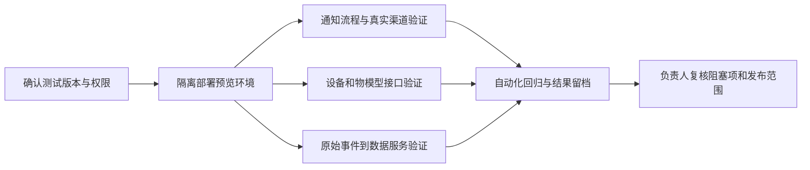

# ThingsPanel 通知、设备与数据服务测试交接入口

更新时间：2026-10-12

这份入口把同事继续开发、验证和部署所需的仓库、在线文档和测试包放在一起。请先看清每项的交付状态：目前通知有可下载的 ARM64 预览包；设备物模型和若干数据服务改动仍留在本地工作区，默认分支链接只代表线上基线，不能当作这些本地改动已经发布。

## 从这里开始

1. 先确认 GitHub 权限。社区后端、社区前端、安装器、公开文档和 Xiaomi 连接器仓库可按仓库页面访问；Encore Core、自动化测试、TPEA 事件适配和 event-ingress 等私有仓库/发布包，需要仓库所有者先授予同事读取权限。
2. 要先试通知安装流程，使用下方 ARM64 预览包和安装器测试指引；在隔离 Linux ARM64 主机或虚拟机上执行，不要在产品环境试装。
3. 设备、物模型和原数据链路，先从对应仓库基线与测试说明开始。若测试目标包含本地未提交改动，先由负责人整理到单独测试分支/包并给出 commit，不能只用默认分支链接代替。
4. 按「如何记录测试结果」提交环境、版本、步骤、实际结果、日志/截图和未通过项；真实渠道账号或设备授权缺失时，记为阻塞，不以 Mock 通过替代。

## 通知与安装器

| 资产 | 在线入口 | 用途与边界 |
| --- | --- | --- |
| ARM64 通知预览包 | [私有预发布页](https://github.com/zjhong/iot-api-encore-kernel/releases/tag/preview-notification-20261010) · [直接下载 TAR](https://github.com/zjhong/iot-api-encore-kernel/releases/download/preview-notification-20261010/notification-preview-arm64-fixed.tar) · [SHA-256](https://github.com/zjhong/iot-api-encore-kernel/releases/download/preview-notification-20261010/notification-preview-arm64-fixed.sha256) | 约 920 MiB；需要 Encore Core 私有仓库读取权限。SHA-256：dbc097e3a9d2415c4df65658f18affb38aa08fc676780dbb57de0d3ec1730c1a。仅测试预览，不是产品版本。 |
| 安装器测试步骤 | [预览测试指南](https://github.com/ThingsPanel/thingspanel-installer/blob/codex/notification-installer-preview-20261010/docs/notification-preview-testing.md) · [安装器预览分支](https://github.com/ThingsPanel/thingspanel-installer/tree/codex/notification-installer-preview-20261010) | 按指南验证全新安装、SMTP 默认配置、升级后配置保留和健康状态。仅在指南标记的隔离实例上测试。 |
| 通知核心候选 | [Encore Core 通知预览分支](https://github.com/zjhong/iot-api-encore-kernel/tree/codex/notification-preview-20261010) · [社区后端候选](https://github.com/ThingsPanel/thingspanel-backend-community/tree/codex/notification-preview-20261010) · [前端候选](https://github.com/ThingsPanel/thingspanel-frontend-community/tree/codex/notification-preview-20261010) · [SMTP 插件候选](https://github.com/ThingsPanel/thingspanel-notification-smtp/tree/codex/notification-smtp-installer-preview-20261010) | 这些是通知预览相关候选分支；请按分支/安装包版本记录测试，不能把它们解释为已合入产品主分支。 |
| 产品使用说明 | [功能总览](https://thingspanel.io/zh-Hans/docs/introduction/functions) · [超管通知配置](https://thingspanel.io/zh-Hans/docs/user-guide/system-admin-operation-manual/system-managment/notice_settings) · [租户默认通知策略](https://thingspanel.io/zh-Hans/docs/user-guide/tenant-operation-manual/warning/Notification_group) · [通知记录](https://thingspanel.io/zh-Hans/docs/user-guide/tenant-operation-manual/warning/Notification_record) · [插件开发指南](https://thingspanel.io/zh-Hans/docs/developer-guide/notification-plugin) | 用户操作和插件契约文档；通知插件/短信/电话的真实服务商联调需要各自有效的测试账号与模板。Twilio 当前延期。 |

预览包验证范围受限：它适合验证 ARM64 隔离环境的安装器和通知预览流程。它不代表所有通知渠道、完整物模型 CRUD、跨平台安装、生产切换/回退均已验收。真实 SMTP 测试也不能替代钉钉、短信和语音渠道的真实账号联调。

## 设备、物模型与数据服务

| 模块 | 在线入口 | 当前使用方式 |
| --- | --- | --- |
| 社区设备与数据 API | [社区后端仓库](https://github.com/ThingsPanel/thingspanel-backend-community) · [设备 API 自动化测试说明](https://github.com/ThingsPanel/thingspanel-backend-community/blob/main/cmd/iot-platform-autotest/README.md) | 自动化说明列出直连设备遥测、属性、事件和命令测试；需准备 Go、Postgres、MQTT 和测试 API Key。网关测试以仓库说明为准。 |
| 设备连接器 | [SRS](https://github.com/ThingsPanel/thingspanel-device-connector-srs) · [萤石](https://github.com/ThingsPanel/thingspanel-device-connector-ezviz) · [小米](https://github.com/ThingsPanel/thingspanel-device-connector-xiaomi) | 按目标设备选连接器。SRS、萤石仓库需要单独授权；具体设备凭证由测试负责人通过安全渠道提供，不写入本页。 |
| Encore 物模型服务 | [Encore Core 仓库](https://github.com/zjhong/iot-api-encore-kernel) · [device metadata 服务说明](https://github.com/zjhong/iot-api-encore-kernel/blob/main/encore-api/devicemetadata/README.md) | Core 的线上仓库已有物模型服务基线；截至本页更新时间，本地 main 领先远端 6 个提交且工作区有未提交改动，含设备分组等变更。当前通知预览包不包含这些本地改动，完整 CRUD 也未做完端到端验收。 |
| 原始事件/上下文适配 | [TPEA 事件适配仓库](https://github.com/zjhong/thingspanel-event-adapter) · [README 与数据契约](https://github.com/zjhong/thingspanel-event-adapter/blob/main/README.md) | 私有仓库。当前本地 main 领先远端 5 个提交且有未提交改动；请用线上 main 作为基线，尚未上传部分要由负责人另行整理测试分支。 |
| 事件接收服务 | [event-ingress 仓库](https://github.com/zjhong/event-ingress) · [事件流程说明](https://github.com/zjhong/event-ingress/blob/main/docs/event-ingress-agent-flow.md) | 私有仓库。线上内容需要授权；本地 main 领先远端 5 个提交且有未提交改动，线上链接不能代表本机最新状态。 |

## 测试自动化与原子动作录制

[ThingsPanel Test Automation 仓库](https://github.com/ThingsPanel/thingspanel-test-automation) 是 UI 自动化、模块用例和录制资产入口（私有仓库）。[模块自动化测试录制规范](https://github.com/ThingsPanel/thingspanel-test-automation/blob/main/docs/%E6%A8%A1%E5%9D%97%E8%87%AA%E5%8A%A8%E5%8C%96%E6%B5%8B%E8%AF%95%E5%BD%95%E5%88%B6.md)要求先整理测试点和用例，再录制/复用原子动作，最后沉淀可重复执行的 Playwright 脚本与结果。仓库本地 main 领先远端 4 个提交；本页只链接已在线版本。

建议覆盖的整条用户流程：登录 → 超管确认可用插件/服务 → 租户设置默认通知策略 → 告警规则选择单独策略或使用租户默认策略 → 触发测试告警 → 查看通知记录与渠道结果。设备与原数据链路则以实际设备/模拟器上报、服务接收、数据查询和故障回放为主。

## 版本状态与协作边界

截至 2026-10-12 的本机盘点显示：社区后端 main 为 ahead 7 / behind 2 并有大量未提交通知与设备改动；社区前端 master 为 ahead 1 / behind 4 并有未提交改动；Encore Core main ahead 6 且工作区有未提交物模型改动；Installer 的 feat/thingmodel-api 在本机且远端未发现同名分支；文档 source 落后远端 2 个提交并有本地改动。TPEA、event-ingress 和自动化仓库也各有未推送提交。除上面明确列出的通知预览候选外，这些本地改动不能由默认分支链接获取。

因此，本轮推荐同事先执行通知 ARM64 预览包测试；设备、物模型和原始数据服务先按在线基线做探索与用例录制。需要覆盖本机改动时，先由对应仓库负责人将选定改动整理到独立测试分支并做最小 CI/集成检查，再更新本入口的分支和 commit。不要把未经验证的本地改动直接合并到产品发布主分支。

## 如何记录测试结果

每个测试记录包含：测试人和日期、主机/系统架构、仓库分支与 commit、安装包 SHA-256、测试账号类型（不记密码）、前置条件、原子步骤、预期/实际结果、截图或脱敏日志、缺陷链接、数据清理情况。真实供应商账号、设备密钥和用户密码通过受控渠道分发；不要写在公开仓库、截图或日志里。

任何渠道没有账号/授权、设备不在线、私有仓库无访问权或测试版本与本页不一致，都应标为「阻塞/版本不匹配」，说明需要谁补什么条件。不要用 Mock 成功、页面显示成功或 HTTP 200 代替真实送达/设备执行结果。

## 交接时需要负责人确认

- 给测试同事开通上述私有仓库和预览包读取权限。
- 确定同事测试的主机架构、隔离环境、设备/模拟器和可用服务商测试账号。
- 为尚在本地的社区后端、前端、Core 物模型、TPEA、event-ingress 与自动化改动指定负责人；由负责人整理独立测试分支后，在本文件补充分支名和 commit。
- 验收通知以告警实际触发、渠道实际结果和租户通知记录为准；验收设备与数据服务以真实设备/模拟器的读写回执和数据查询为准。

本页只作为导航与版本状态记录，不含密钥、账号密码和内部验收附件。