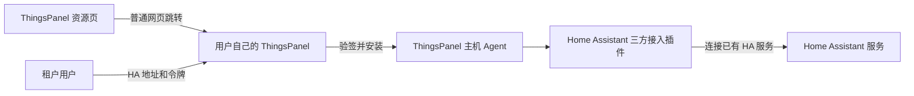

# 插件开发、发布与安装全流程

本文说明 ThingsPanel 当前对设备接入插件、第三方服务插件和通知插件的处理方式。它们使用不同的契约和管理入口。在平台中登记插件，不代表它已发布到公开资源中心。

> **Home Assistant 插件的准确含义：**这里说的 Home Assistant 插件，是 **ThingsPanel 的 Home Assistant 三方接入服务插件**。它不是 Home Assistant 网站，不是安装在 HA 内部的 Add-on，也不是让用户跳转到 HA 商店安装的集成。用户需要先有一个正在运行、可被 ThingsPanel 访问的 Home Assistant 服务；插件运行在 ThingsPanel 一侧。租户之后在 ThingsPanel 接入点里填写自己的 HA 地址和令牌。



安装和租户配置都在 ThingsPanel 中完成。该插件不会替用户安装或配置 Home Assistant 本身。

## 1. 先确定插件类型

| 类型 | 用途 | 平台管理入口 | 是否自动公开上架 |
| --- | --- | --- | --- |
| 设备接入协议插件 | 通过某种协议或协议服务连接设备 | 现有插件管理页面区分协议服务（`service_type=1`）和服务插件（`service_type=2`）。按所选协议插件自己的 SDK 和运行契约开发。 | 平台登记不等于公开市场上架；公开发布仍需单独审核和维护条目。 |
| 第三方服务插件 | 连接 ThingsPanel 与外部服务，例如 Home Assistant | 由平台安装器安装经过签名的插件目录和制品。平台超级管理员负责安装；每个租户随后配置自己的服务接入点。 | 当前 Home Assistant 资源页用于介绍和跳转，不是制品仓库，也不是作者上传入口。 |
| 通知插件 | 将通知核心适配到邮件、短信或消息服务商 | 使用独立通知插件契约。系统超级管理员登记插件、管理服务商账号并授权租户。 | 发布源码不等于已登记或分发到 ThingsPanel 实例。参见[通知插件开发指南](./notification-plugin.md)和[通知服务与插件管理](../user-guide/system-admin-operation-manual/system-managment/notice_settings.md)。 |

旧的[可视化插件发布指南](./developing-plug-in/visualPublishPlugin.md)已标为弃用且不兼容当前版本，不能作为设备接入、第三方服务或通知插件的发布流程。

## 2. 当前“发布到市场”具体包含什么

以下是三个不同动作：

1. **构建并发布插件：**产出带版本号的安装包或容器镜像及其元数据。
2. **登记到 ThingsPanel 实例：**协议/服务插件在平台插件管理中登记；通知插件在自己的插件目录登记。授权租户和配置凭据是另外的步骤。
3. **在公开资源中心上架：**资源中心维护人员审核后，发布介绍条目，并指向对应版本和安装入口。

当前没有一个面向作者、能接收所有类型插件并自动完成以上三项的统一上传入口。公开源码仓库、平台中的插件登记和资源中心公开条目不能相互替代。

## 3. 插件从开发到发布：Home Assistant 的实际操作链

发布不是“把源码推到 GitHub”一个动作。下面按参与人说明源码、签名制品、主机更新、平台安装和资源中心页面的先后关系。本文描述当前已公开的安装器和插件制品，并单独列出仍待完成的平台端与干净主机验收。

### 3.1 插件开发者：提交可复现的源码

1. 在插件自己的仓库实现 ThingsPanel 插件契约，补齐配置字段、启动参数、健康检查和必要测试。HA 连接器是运行在 ThingsPanel 主机上的三方服务插件，HA 地址和认证信息由租户稍后在 ThingsPanel 接入点填写。
2. 将依赖固定到已发布的 SDK 版本；不能用本机 `replace`、未提交文件或未发布的 SDK 提交来构建公共制品。
3. 提交变更并通过代码审查。记录插件源代码完整 commit、插件语义版本和使用的 SDK tag/commit。发布构建必须从这组不可变提交产生。

### 3.2 ThingsPanel 发布负责人：构建并签名候选制品

正式发布制品由 `.github/workflows/ha-plugin-candidate.yml` 构建，由有权限的发布负责人在 GitHub Actions 手动启动，填写：插件版本、HA 源码完整 commit、SDK tag、SDK 对应完整 commit。工作流会校验 SDK tag 指向的 commit 与输入一致，要求 HA 工作区干净且 `go.mod` 使用该已发布 SDK，然后针对 `linux/amd64` 和 `linux/arm64` 分别构建 Agent 和 HA 容器镜像。

每个架构产物包含 Agent、Docker 镜像归档、catalog JSON 和签名。catalog 记录插件/镜像版本、镜像 ID、镜像归档 SHA-256、Agent SHA-256、目标架构及源代码/SDK/安装器 commit。CI 使用仓库受控的 `TP_PLUGIN_CATALOG_SIGNING_KEY` 对 catalog 签名，并用安装器中独立固定的公钥验签。签名私钥不得下载、打印或放进插件仓库、制品、公开页面或聊天。

**当前已核实：**版本 `1.0.0` 已发布在公开的插件专用 GitHub Release [`plugin-ha-v1.0.0`](https://github.com/ThingsPanel/thingspanel-installer/releases/tag/plugin-ha-v1.0.0)。匹配的 `linux/amd64` 和 `linux/arm64` 签名 catalog 已在 `https://install.thingspanel.io/plugins/` 公开。我们从公网 URL 下载并验证了 catalog 签名、辅助脚本 SHA-256 固定值和四个 Release 制品摘要。公开安装器 Pages 使用分支 `codex/ha-plugin-public-site-20261108`，提交 `72946f1`。这证明公开分发及完整性校验可用，不代表任意干净主机安装或资源中心到平台的完整链路已验收。

### 3.3 安装器维护者：把受信分发接入安装/升级

公开安装器的工作流程是：官方安装或升级流程先更新已审查的 updater；updater 使用源码内置的 SHA-256 pins 下载并校验必要辅助脚本；信任根来自经过审查的安装器代码（并在 catalog 之外固定），用户不需要从 catalog 自行下载或输入公钥。随后安装器从 `https://install.thingspanel.io/plugins/catalog-linux-{amd64,arm64}.json` 及对应 `.sig` 取出当前主机架构 catalog，并从固定的 ThingsPanel GitHub Release 地址下载 catalog 指定的 Agent 与 HA 镜像归档。

安装器先验证 catalog 签名，再核对 Agent/镜像归档摘要、目标机器架构和镜像 ID；只有校验通过才加载镜像、启动受管 Agent。租户/超管在网页点击按钮不会直接传输或执行这些文件。已有主机也要先运行包含该安装器改动的受支持安装/升级流程；仅打开新网页链接不会替旧主机更新 Agent。

**当前已核实：**公开安装/升级链路可下载固定摘要辅助脚本和架构对应的签名 catalog，并校验选中的 Agent 与镜像归档。双架构制品均从公网 URL 分发并与签名 catalog 摘要一致；使用公网 arm64 bundle 的隔离运行 smoke 已通过 Agent catalog、prepare、grant、activate、health、renew 和 revoke 调用。完整干净主机安装/升级及平台 UI 验收仍待完成，不能从该 smoke 推断通过。

### 3.4 平台系统超级管理员、租户和资源中心维护者

1. 安装器正式更新部署并启动 Agent 后，平台系统超级管理员（`SYS_ADMIN`）登录 ThingsPanel，打开 `/apply/plugin?tab=install&plugin=homeassistant`，从 Agent 提供的已验签 catalog 选中并安装连接器。此处不填 HA 地址或令牌。
2. 租户用户登录自己的租户，在**设备 → 三方接入**（`/device/integration`）创建自己的 HA 服务接入点，填写 HA 地址和租户自己的令牌，再按现有流程选择实体。插件安装是平台范围能力；接入点和凭据按租户隔离。
3. 资源中心维护者审核并维护公开介绍页。页面可以链接到用户指定 ThingsPanel 实例的安装网页，但链接只是普通浏览器导航；页面不会带来镜像，不绕过登录/`SYS_ADMIN` 权限，也不会替服务器安装或升级 Agent。

成功的网页跳转、Actions artifact 或资源中心介绍页都不能单独证明插件正式发布。只有固定版本的 source commit、签名 catalog、公钥指纹、Agent/镜像摘要、永久下载位置、可用安装器版本和实际安装结果相互对应，并通过验收，才可对外宣布发布。

## 4. Home Assistant 安装与租户配置

当前预期流程如下：

1. 主机已通过包含正式安装器更新的受支持安装/升级流程，并且对应架构的可信 catalog、镜像和 Agent 已可用后，平台**系统超级管理员（`SYS_ADMIN`）**登录该 ThingsPanel 实例，打开插件安装页并安装 Home Assistant。安装时不填写 HA 地址或令牌；租户用户不能执行这项平台安装。仅从资源页点进来不会更新老主机上的 Agent。
2. 租户用户登录所属租户，打开**设备 → 三方接入**（`/device/integration`），创建自己的 Home Assistant 接入点，并填写平台可访问的 HA 地址和该租户自己的长期访问令牌。
3. 租户选择需要的实体，并通过现有设备接入流程完成配置。认证信息属于该租户的接入点，不应放进公开插件包、R 页面、日志或文档。

插件进程健康不代表某个租户的 HA 地址和令牌有效。插件健康状态应与各租户接入点的连接状态分别展示。

## 5. 资源中心按钮如何工作

例如下面这个链接：

```text
https://<用户可访问的 ThingsPanel 主机>/apply/plugin?tab=install&plugin=homeassistant
```

它只是跳转到指定 ThingsPanel 主机的普通网页链接。`tab=install` 参数让插件页打开“安装”标签，`plugin=homeassistant` 参数则让安装页在该主机 catalog 中找到插件后自动选中并打开安装抽屉。页面需要登录，安装操作要求平台 `SYS_ADMIN`。主机还必须先运行带有经审查信任根 pin 的受支持安装器版本，并能访问匹配架构的签名 catalog、Agent 和镜像。之后平台和 Agent 执行授权、签名校验和插件安装。

链接本身不会传送插件镜像、授予平台权限、更新主机 Agent 或执行安装。指向 `127.0.0.1` 或 `localhost` 的链接会访问正在打开浏览器的那台电脑；只有 ThingsPanel 也运行在同一台电脑时才适合本机演示。公开条目应使用预期的可访问平台/安装流程，不能把开发者的回环地址作为通用安装链接。

## 6. 当前 Home Assistant 发布状态

[Home Assistant 资源中心页面](https://r.thingspanel.cn/marketplace/plugins/homeassistant)是 ThingsPanel 三方服务插件的公开介绍和安装跳转页，不是 Home Assistant 应用，也不会在访问者电脑上运行安装器。当前页面文案已准确说明：用户填写自己的 ThingsPanel 平台地址，并以该平台超级管理员身份登录。

**公开分发已可用：**插件版本 `1.0.0` 已发布为插件专用 GitHub Release [`plugin-ha-v1.0.0`](https://github.com/ThingsPanel/thingspanel-installer/releases/tag/plugin-ha-v1.0.0)，提供 Linux amd64 和 arm64 的签名 catalog 与匹配制品。公网 catalog 签名、辅助脚本固定摘要、制品摘要、公网下载暂存以及隔离 arm64 runtime 生命周期 smoke 均已验证。

**仍待验收：**尚未完成全新的 ThingsPanel 干净安装；没有实际操作线上资源中心跳转到真实平台的完整安装流程；没有连接生产平台后端或 Home Assistant 端点。设备遥测、命令和租户 HA 连通性不属于已完成 smoke 的范围。不能把这些场景说成已验证，也无需把它们设为启动本轮手工安装验收的前置条件。

手工测试时分别记录 ThingsPanel revision、安装器/Agent 版本、主机架构、干净安装或升级、平台超级管理员安装结果、插件健康状态、租户接入点结果。截图和日志不得包含租户 HA 凭据。插件健康不等于租户连接成功。
