# Matter

Matter 连接器让 ThingsPanel 能够发现、绑定、监控和控制局域网内的 **Matter** 灯具（开关灯和调光灯）。它属于「三方接入」类连接器：安装一次，建立接入点，再导入需要的设备。

:::caution 状态：候选版本
该连接器只在 connectedhomeip 灯具**模拟器**上做过端到端测试（安装、发现、绑定、遥测、命令、租户隔离）。**尚未**用真实 Matter 硬件、Thread 设备、真实局域网组播、断电恢复和长时间稳定性验证。请用于评估，不要用于生产。
:::

## 1. 功能概览

- **发现**：列出已与网关运行时配对的 Matter 节点，显示其中的开关灯或调光灯端点。
- **上报**：Matter 属性上报转换为遥测（`power`、`brightness_pct`），可达性转换为在线/离线。
- **控制**：ThingsPanel 下发的 `set_power`、`set_brightness` 命令会发送给设备。
- **范围**：支持 On/Off 簇的灯具，可选 Level Control。不支持 Thread，不支持传感器、门锁、温控器等。

## 2. 工作原理

```
Matter 设备（你的局域网，IPv6 + mDNS）
        ▲
Matter 网关运行时   ← 由你自己运行，在 Agent 之外（需要访问局域网；保存 Matter "fabric" 数据）
        ▲  TCP :7001，共享令牌（请只放在私有网络）
Matter 连接器       ← 在插件管理里安装（由 Agent 运行）
        ▲
ThingsPanel 平台 + MQTT Broker
```

连接器刻意做得很小。所有需要访问局域网的事情（设备发现、配对、Matter fabric 凭据）都在**网关运行时**里，由你自己运行。Agent 只管理连接器。

## 3. 前提条件

- ThingsPanel 平台支持**插件安装**（受管运行时身份），并且签名插件目录里包含 Matter 连接器，由管理员提供。
- 一台与 Matter 设备处于**同一 IP 网络（及 IPv6/mDNS 组播域）**的 Linux 主机，已安装 Docker。Mac/Windows 的 Docker Desktop 里的容器无法加入局域网组播域，真实设备请使用 Linux。
- 为网关运行时准备一个持久化的 Docker 卷。它保存 Matter fabric（让 ThingsPanel 能控制你设备的密钥），请备份并且不要外泄。
- 设备需支持 Matter on-network（Wi-Fi/以太网）。不支持 Thread 设备。

## 4. 运行网关运行时

生成共享令牌（至少 32 个字符），在局域网主机上启动网关运行时：

```bash
openssl rand -hex 32          # 记下这个值，它就是连接器的令牌

docker run -d --name matter-gateway --restart unless-stopped \
  --network host \
  -v matter-gateway-data:/var/lib/thingspanel-matter \
  --tmpfs /tmp:rw,nosuid,nodev,size=64m \
  -e MATTER_CONTROLLER_TOKEN=<令牌> \
  thingspanel-matter-gateway:<版本>
```

说明：

- 网关镜像由 Matter 连接器仓库构建（`connector/Dockerfile.gateway`），镜像和版本请向管理员获取。
- 该端点监听 `7001` 端口，使用**明文 TCP**。配对码会经过这个端口，所以请只放在私有网络，并且只允许连接器所在主机访问。
- 连接器必须能访问 `<网关主机>:7001`，该地址由管理员写在 Matter 目录条目里。

## 5. 安装连接器

此步骤由平台管理员完成。

1. 打开**应用管理 → 插件管理**，切换到**插件安装**标签。
2. 找到 **Matter** 卡片（名称和版本由你们的插件目录条目决定），点击**安装**。
3. 填写第 4 步的网关令牌（`MATTER_CONTROLLER_TOKEN`）。该值由 Agent 保存，之后只显示为「已设置」。

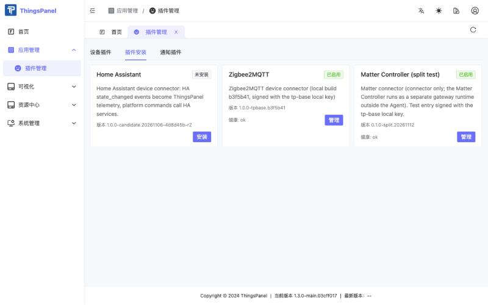

稍等片刻，卡片显示**已启用**。点击**管理**可以查看安装步骤和健康状态。

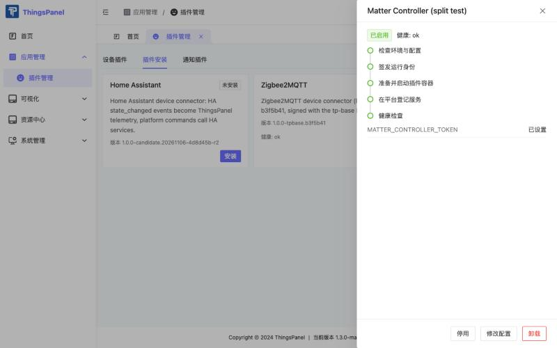

## 6. 让灯具与网关配对

配对在网关主机上进行，不在 ThingsPanel 里。先让灯具进入配对模式（或在厂商 App 里打开配对窗口），然后执行：

```bash
docker exec -it matter-gateway /connector matterctl commission --timeout-seconds 30
```

命令会提示输入配对码（PIN），输入时不回显；配对码只发送一次给本地控制器，不会写入日志或存储。查看结果：

```bash
docker exec matter-gateway /connector matterctl list
```

每个已配对的开关灯或调光灯端点都会列出节点号和端点号。要把节点从 Matter fabric 中移除（在 ThingsPanel 里解绑**不会**移除）：

```bash
docker exec matter-gateway /connector matterctl remove --node-id <节点号> --confirm
```

## 7. 创建物模型和设备模板

ThingsPanel 下发的命令由**物模型**定义。每个租户做一次即可。

### 7.1 物模型

1. 打开**设备接入 → 物模型**，点击**新建物模型**，填写名称（例如 `Matter Dimmable Light`）和版本，保存。

   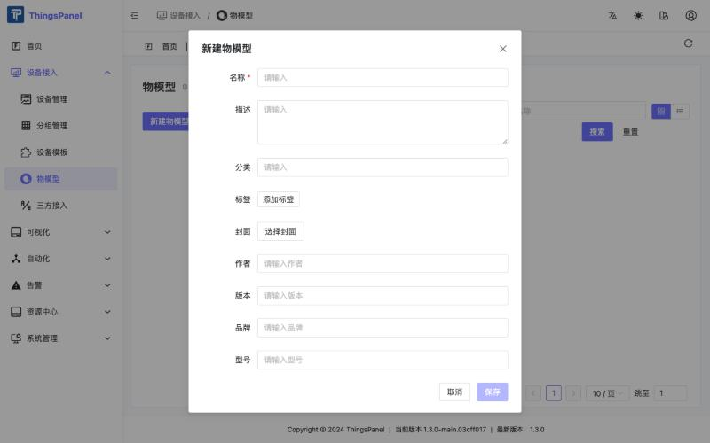

2. 打开**物模型定义**标签，在**遥测**下新增两个字段：

   | 名称 | 标识符 | 数据类型 |
   |---|---|---|
   | Power | `power` | Boolean |
   | Brightness | `brightness_pct` | Number |

   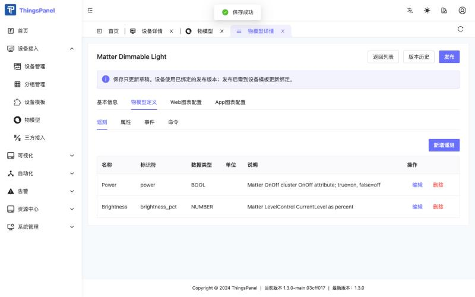

3. 在**命令**下新增两条命令，各带一个参数：

   | 名称 | 标识符 | 参数 | 类型 |
   |---|---|---|---|
   | Set power | `set_power` | `value` | Boolean（true 为开） |
   | Set brightness | `set_brightness` | `value` | Number（0–100） |

   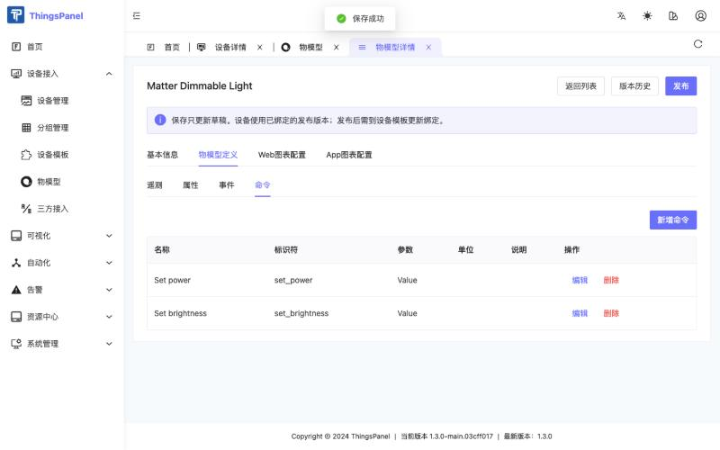

4. 点击**发布**。设备使用的是已发布版本；之后修改草稿不会影响设备，直到你绑定新版本。

   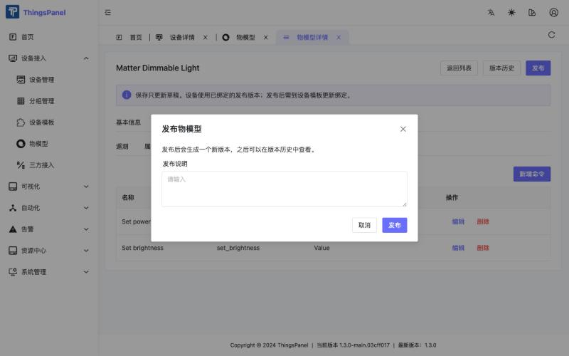

### 7.2 设备模板

发现对话框会为每台设备提供一个**设备模板**。用连接器仓库里的脚本为 Matter 连接器创建一个（它调用的是界面使用的同一套 API）：

```bash
TOKEN=$(curl -s -X POST https://<平台地址>/api/v1/login -H 'content-type: application/json' \
  -d '{"email":"<租户用户>","password":"<密码>"}' | jq -r .data.token)

TP_BASE_URL=https://<平台地址> TP_TOKEN=$TOKEN \
  scripts/create-matter-template.py templates/dimmable-light.json --config-only --protocol-type matter
```

然后打开**设备接入 → 设备模板**，进入新建的 **Matter Dimmable Light** 模板，切换到**物模型**标签，选择你的物模型及其已发布版本，点击**保存**。

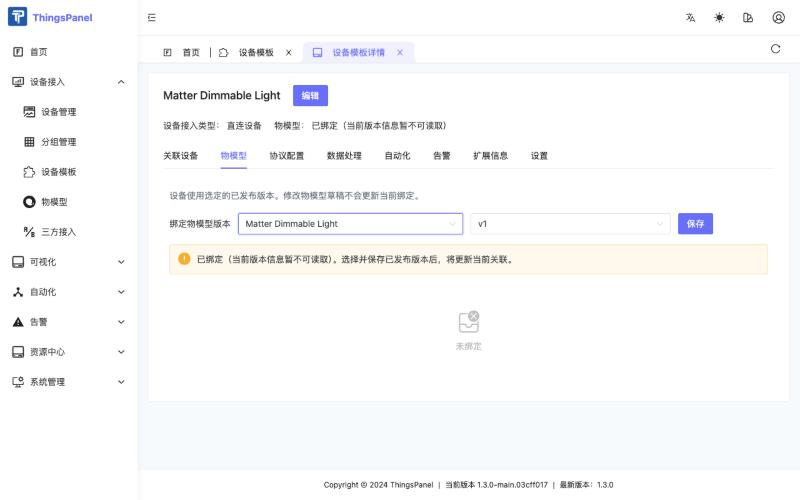

:::note
`--protocol-type` 是已安装连接器的服务标识符（除非管理员另有设定，否则是 `matter`）。
:::

## 8. 新建接入点并绑定设备

1. 打开**设备接入 → 三方接入**，点击 **Matter** 卡片。

   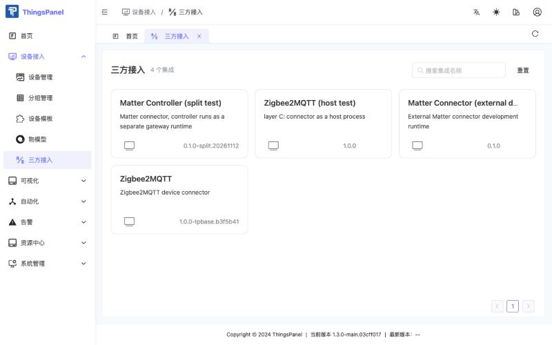

2. 点击**新建接入**，填写名称，模式保持**手动**。Matter 连接器不需要其他设置。点击**保存并下一步**。

   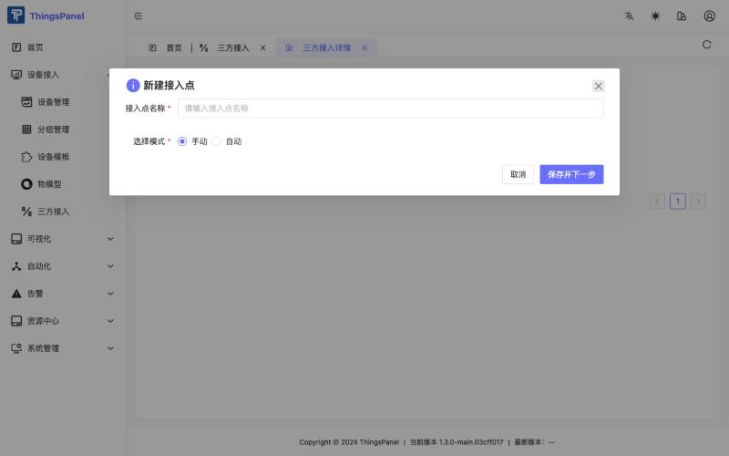

   **每个网关运行时只用一个接入点**：网关会固定到第一个使用它的接入点（及租户）。

3. 对话框会列出网关发现的设备。

   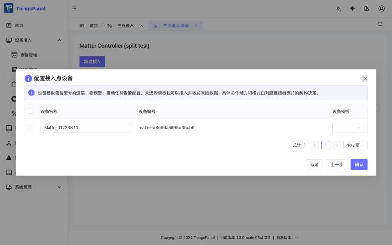

   勾选设备，在**设备模板**列选择第 7 步的模板，点击**确认**。

   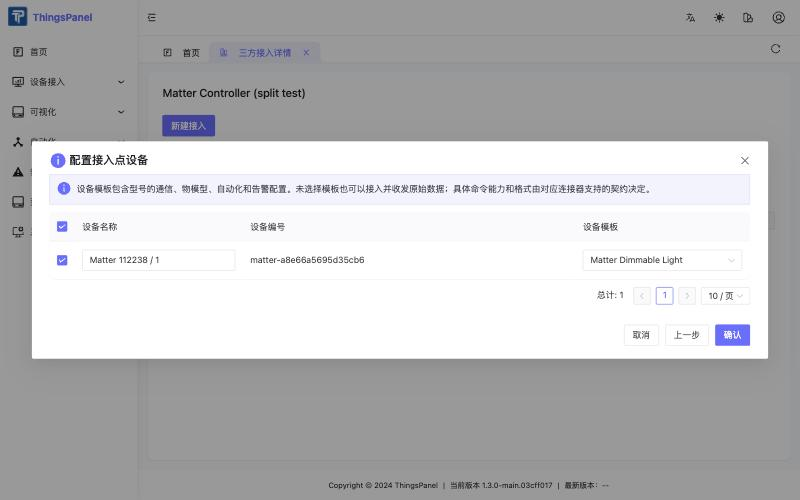

   :::caution
   如果没有勾选设备就点**确认**，ThingsPanel 只会提示「接入点配置已保存」，不会绑定任何设备。请先勾选设备。
   :::

4. 接入点列表里出现你的接入点。**查看设备**打开设备列表；**修改配置**可重新打开对话框绑定更多设备。

   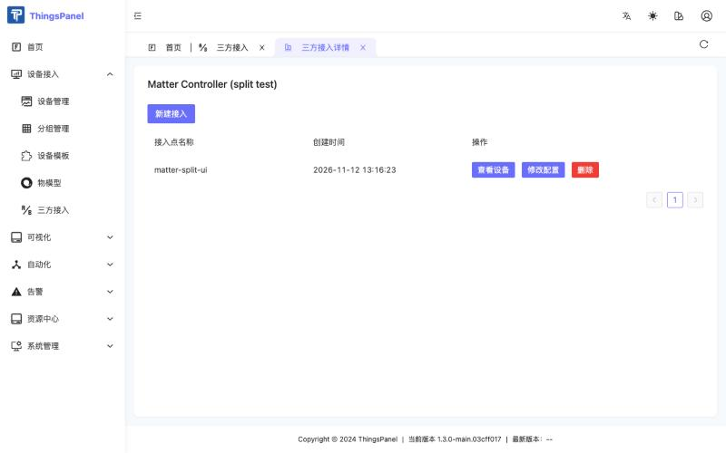

新绑定的设备约两分钟内会被连接器接管并显示在线。如果一直离线，请管理员刷新 Broker 的设备范围。

## 9. 监控与控制

打开**设备接入 → 设备管理**。

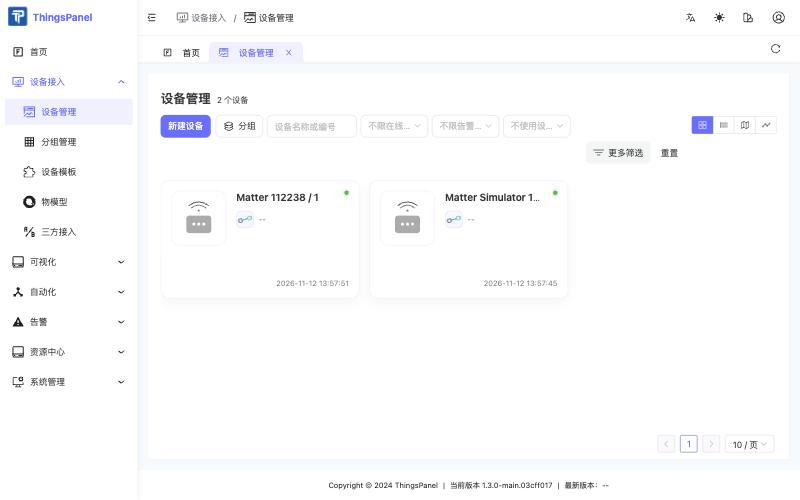

打开设备，**遥测**标签显示 `power` 和 `brightness_pct`。

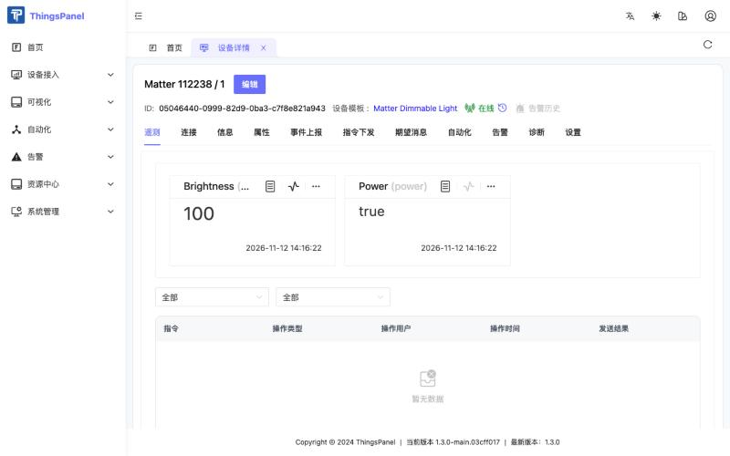

打开**指令下发**标签，点击**下发命令**，选择 `Set power` 或 `Set brightness`，设置 **Value**，点击**下发**。

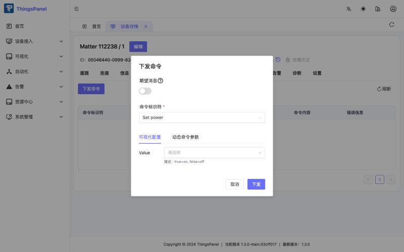

命令列表显示结果。「返回成功」表示 Matter 控制器已接受命令，新的状态随后以遥测形式到达。

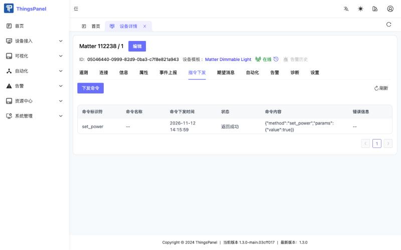

### 遥测与命令

| 项目 | 标识符 | 取值 |
|---|---|---|
| 遥测 | `power` | `true` / `false` |
| 遥测 | `brightness_pct` | 整数 0–100（映射到 Matter 亮度级别 1–254） |
| 命令 | `set_power` | `{"value": true}` 或 `{"value": false}` |
| 命令 | `set_brightness` | `{"value": 0..100}` |

也可以通过平台 API（`POST /api/v1/command/datas/pub`）用相同的标识符和值下发命令。

## 10. 已知限制与常见问题

**绑定成功了，设备列表却是空的。** 如果平台前端只从新的设备库（`/api/v2/devices`）列设备，通过三方接入绑定的设备暂时不会显示。设备本身存在且可用（遥测、命令、模板都正常），可以从模板的**关联设备**标签打开，或使用已发布的 v1.3.0 前端。这是平台限制，不是 Matter 的问题；Zigbee2MQTT 等其他三方接入连接器也一样。

**命令对话框里没有命令。** 设备模板没有绑定已发布的物模型版本。见第 7 节和对话框里的提示。

**绑定后设备一直离线。** 请等待连接器的状态刷新，最长约两分钟。平台 Broker 的设备范围必须包含新设备，如果没有，请管理员刷新。

**亮度变化的遥测来得晚。** 我们测试时模拟器的亮度上报最多晚约 40 秒；请用你的设备测一下实际延迟。

**在 ThingsPanel 解绑设备不会把它从 Matter fabric 中移除。** 请在网关主机上用 `matterctl remove`。

**多个接入点。** 一个网关运行时只服务一个接入点。其他租户或站点请再运行一个网关运行时（以及另一个连接器实例）。

**安全。** 网关令牌和 fabric 卷可以控制你的设备。请把端点放在私有网络，不要公开令牌，也不要把开发或模拟器的信任根放进生产网关。

构建方法、架构和测试记录请见 Matter 连接器仓库。
