# Zigbee2MQTT 接入

Zigbee2MQTT 连接器把由 [Zigbee2MQTT](https://www.zigbee2mqtt.io/)（简称 Z2M）管理的 Zigbee 设备接入 ThingsPanel。读完本指南，你可以安装连接器、发现 Z2M 已配对的设备、批量绑定、查看遥测，并下发开关、亮度等命令。

截图为中文界面，英文版对应的菜单和按钮以“English（中文）”形式给出。各步骤标注了 **管理员**（平台管理员）或 **租户用户**。

## 1. 功能概览

- **发现**：连接器读取 Z2M 的 retained `bridge/devices` 列表，在 ThingsPanel 中显示已配对设备，供批量绑定。
- **上报**：设备状态（温度、湿度、开关、亮度等）作为遥测上报；开启 Z2M availability 后，还会上报在线/离线。
- **控制**：支持开关、亮度，以及设备 exposes 中任何可写属性；下发后会读回设备状态确认。
- 设备以 IEEE 地址标识，在 Z2M 里给设备改名不会破坏绑定。
- **适用范围**：Zigbee2MQTT 通过 MQTT 暴露的设备——灯（开关、亮度）、插座和开关，以及温度、湿度等数值型传感器。文档基于 ThingsPanel v1.3.0。

## 2. 工作原理

```
Zigbee 设备 ── Zigbee2MQTT ── MQTT Broker ◀── Zigbee2MQTT 连接器 ──▶ ThingsPanel
  （无线）      （你来运行）    （你来运行）     （插件，由平台运行）
```

Zigbee2MQTT 和它的 MQTT Broker 由你运行。连接器是由平台管理员安装的插件，它按你在接入点里填写的地址连接你的 Z2M Broker，所以不需要 Zigbee2MQTT 插件，也不依赖 Home Assistant 整合。

## 3. 前提条件

- 支持插件安装的 ThingsPanel 平台，且插件目录中提供 Zigbee2MQTT 插件。
- 连接到运行 Z2M 的机器上的 Zigbee 协调器（USB 网关棒）。
- Z2M 和平台插件运行环境都能访问的 MQTT Broker。
- Z2M 的 Home Assistant 整合保持**关闭**。

## 4. 部署 Zigbee2MQTT

下面的 `docker-compose.yml` 同时运行 Mosquitto 和 Zigbee2MQTT。请把设备路径改成你的协调器路径（`/dev/ttyUSB0` 只是示例）。

```yaml
services:
  mosquitto:
    image: eclipse-mosquitto:2
    restart: unless-stopped
    ports:
      - "1883:1883"
    volumes:
      - ./mosquitto/config:/mosquitto/config
      - ./mosquitto/data:/mosquitto/data

  zigbee2mqtt:
    image: koenkk/zigbee2mqtt
    restart: unless-stopped
    depends_on:
      - mosquitto
    ports:
      - "8080:8080"          # Z2M 网页界面
    volumes:
      - ./z2m-data:/app/data
    devices:
      - /dev/ttyUSB0:/dev/ttyUSB0
```

`mosquitto/config/mosquitto.conf`：

```conf
persistence true
persistence_location /mosquitto/data/
listener 1883
allow_anonymous false
password_file /mosquitto/config/passwords
```

用 `mosquitto_passwd -c mosquitto/config/passwords <用户名>` 创建密码文件，然后编写 `z2m-data/configuration.yaml`：

```yaml
homeassistant: false
permit_join: false
mqtt:
  base_topic: zigbee2mqtt
  server: mqtt://mosquitto:1883
  user: <MQTT 用户名>
  password: <MQTT 密码>
serial:
  port: /dev/ttyUSB0
frontend:
  port: 8080
availability: true
```

:::caution
不要手工添加或复制 `network_key`、`pan_id`：Z2M 首次启动会自动生成。请勿公开或分享你的 `configuration.yaml`，其中包含 Zigbee 网络密钥。
:::

`availability: true` 让 Z2M 报告设备离线；不开启时，ThingsPanel 只能在设备发数据时得知它在线，不会把它标成离线。只把 Broker 暴露给可信网络，并保持认证开启。用 `docker compose up -d` 启动。

## 5. 安装连接器（管理员）

1. 打开**应用管理** → **插件管理**，切换到**插件安装**标签页。
2. 找到 **Zigbee2MQTT** 卡片。安装完成后，卡片显示**已启用**和`健康: ok`。

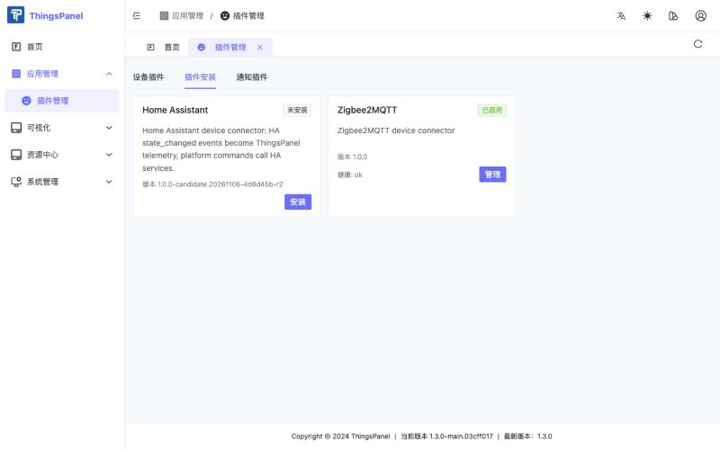

安装后，租户用户可在**设备接入** → **三方接入**里看到 **Zigbee2MQTT** 集成。

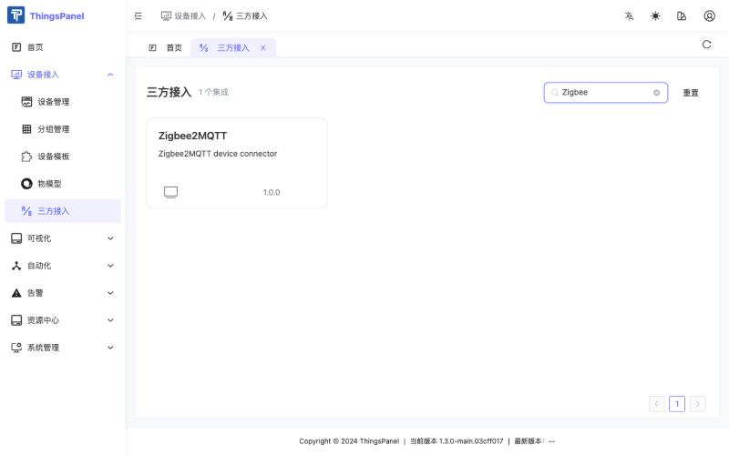

## 6. 在 Zigbee2MQTT 中配对设备

配对在 Zigbee2MQTT 里完成，而不是在 ThingsPanel 里：

1. 打开 Z2M 网页界面，点击 **Permit join (All)**，或临时设置 `permit_join: true`。
2. 让设备进入配对模式（通常长按其复位键数秒）。
3. 等 Z2M 显示设备已完成 interview 后，再关闭 permit join。

## 7. 创建物模型和设备模板（租户用户）

命令来自**已发布的物模型**。遥测没有物模型也会保存，但物模型能给数值命名、加单位；设备模板把物模型和设备关联起来。

### 7.1 创建物模型

1. 打开**设备接入** → **物模型**，点击**新建物模型**，输入名称（例如 `Zigbee Light`）并保存。

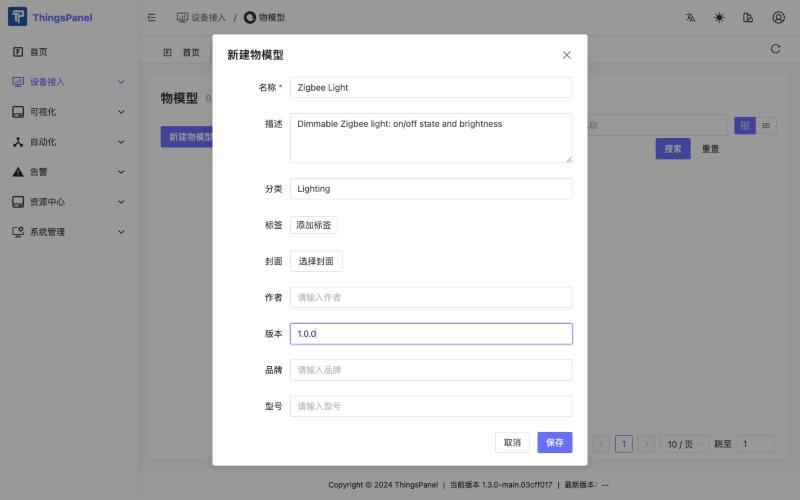

2. 在**物模型定义** → **遥测**中点击**新增遥测**。标识符必须与 Z2M 的属性名一致。

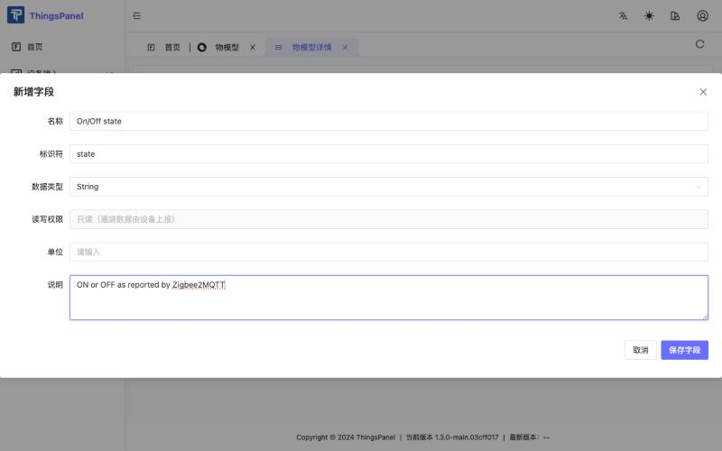

3. 在**命令**标签页点击**新增命令**，为每个命令添加一个参数。

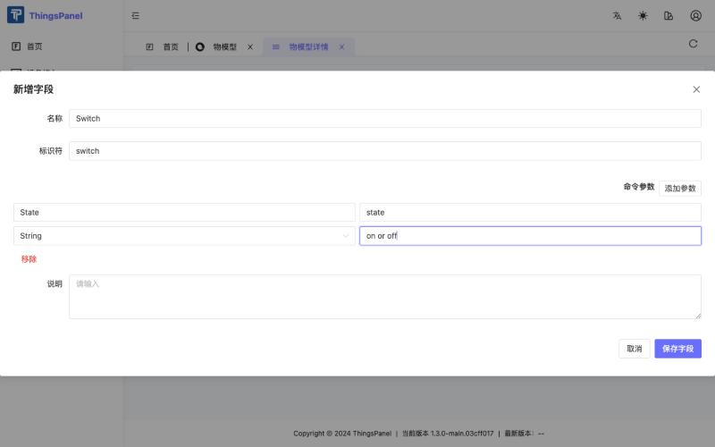

建议的字段：

| 设备 | 遥测标识符 | 命令标识符（参数） |
|---|---|---|
| 灯 | `state`（String）、`brightness`（Number，0–254） | `switch`（`state`：on / off）、`set_brightness`（`level`：1–100） |
| 温湿度传感器 | `temperature`（Number）、`humidity`（Number） | 无 |

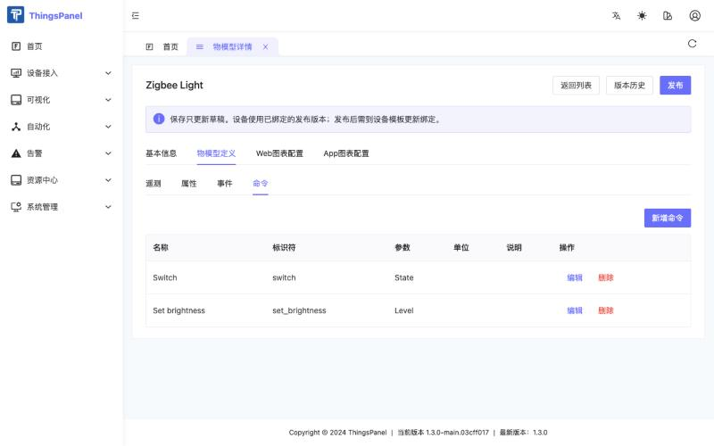

:::caution
同一个物模型中，命令标识符不能与遥测标识符相同，平台会拒绝这样的命令。所以亮度命令叫 `set_brightness`，而遥测叫 `brightness`。连接器接受任意命令名的 `set_<名称>` 写法。
:::

4. 点击**发布**，填写发布说明并确认。物模型发布后才能使用。

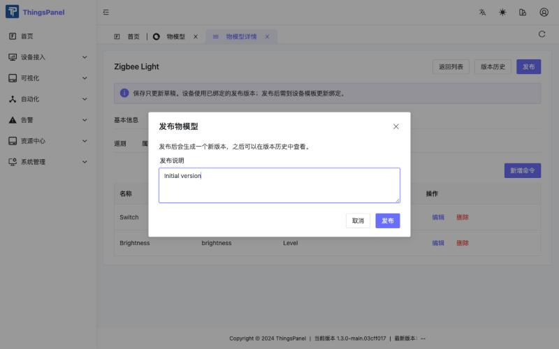

### 7.2 创建设备模板

1. 打开**设备模板**，点击**新建设备模板**。输入名称，接入类型选**直连设备**，在**选择协议/服务**中选 **Zigbee2MQTT**，点击**确定**。

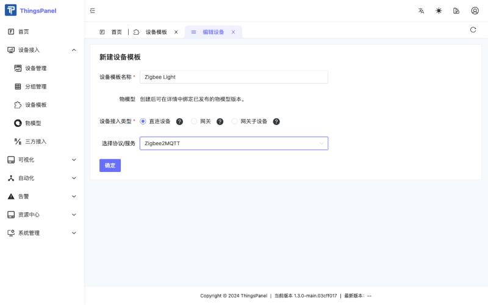

2. 打开该模板，切换到**物模型**标签页，选择已发布的物模型和版本，点击**保存**。物模型发布新版本后，需要在这里重新选择新版本。

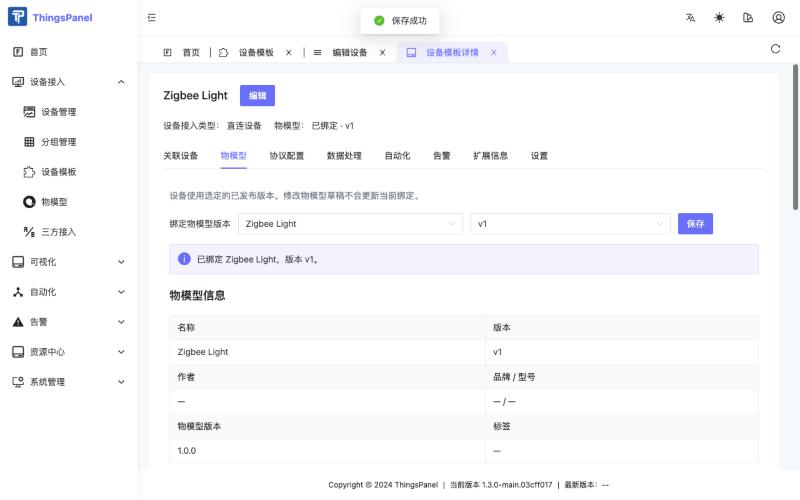

## 8. 新建接入点并绑定设备（租户用户）

1. 打开**设备接入** → **三方接入** → **Zigbee2MQTT**。

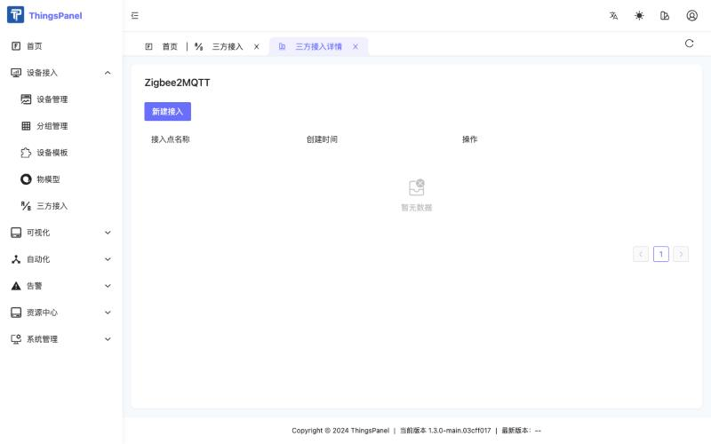

2. 点击**新建接入**并填写表单。

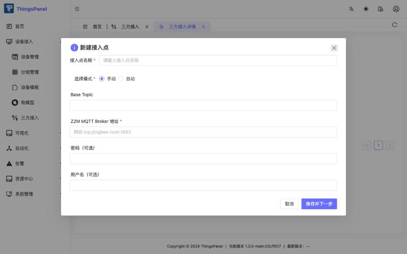

| 字段 | 说明 |
|---|---|
| 接入点名称 | 任意名称 |
| 选择模式 | 保持**手动** |
| Base Topic | Z2M 的 `base_topic`，默认 `zigbee2mqtt` |
| Z2M MQTT Broker 地址 | Z2M 发布消息的 Broker，例如 `tcp://<broker 地址>:1883`；平台必须能访问它 |
| 用户名 / 密码（可选） | Broker 需要认证时填写 |

每个接入点各自连接自己的 Z2M Broker；有多套 Z2M 时，为每套各建一个接入点。

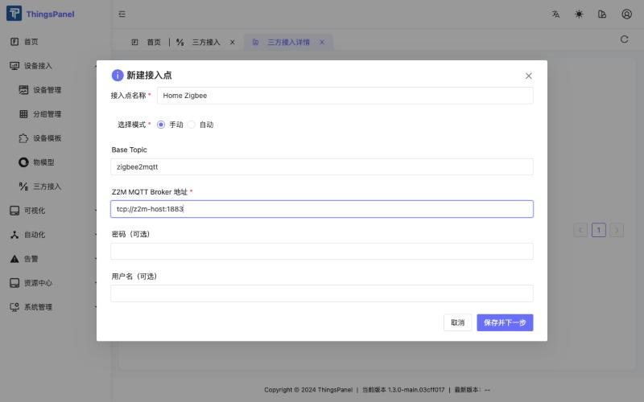

3. 点击**保存并下一步**。连接器会列出 Z2M 已配对且已完成 interview 的设备（协调器、不受支持和已禁用的设备不会列出）。之后再次打开该接入点时，点击**修改配置** → **保存并下一步**即可回到这个列表。

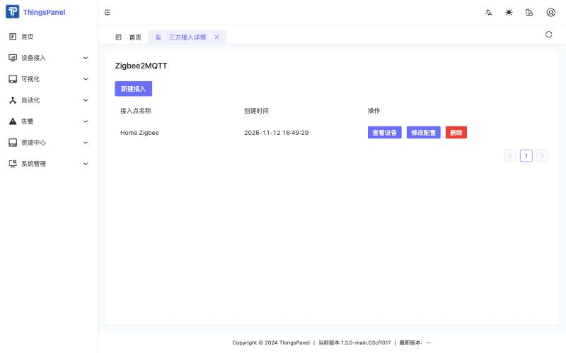

4. **先勾选要绑定的设备**，为每台设备选择设备模板（灯选 `Zigbee Light`），再点击**确认**。没有勾选设备就不会绑定任何设备。

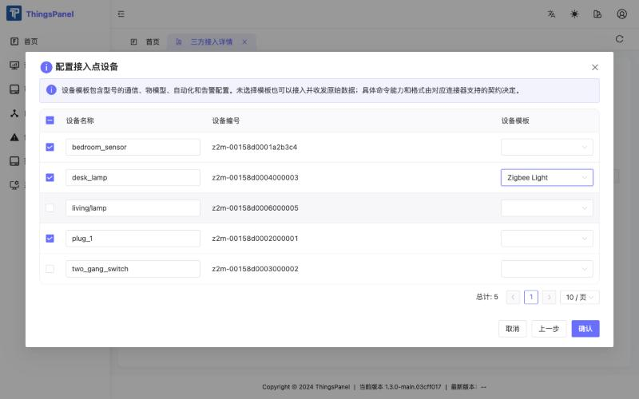

不选模板的设备仍会上报原始数据，但命令需要带已发布物模型的模板。

## 9. 监控与控制（租户用户）

1. 打开**设备接入** → **设备管理**。连接器约 30 秒内获取新的绑定；设备通常约一分钟内变为在线（绿点），最长可能需要两分钟。

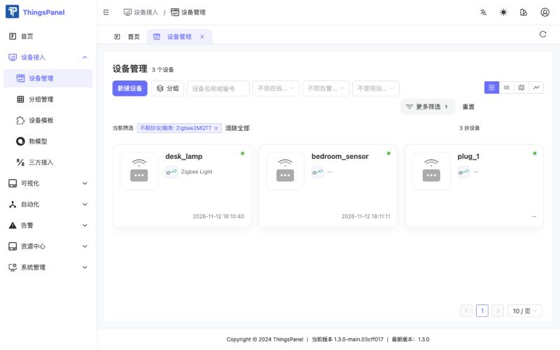

2. 打开设备，停留在**遥测**标签页。数值按物模型命名；不在物模型中的键显示为“绑定版本未定义”，例如 `linkquality`。

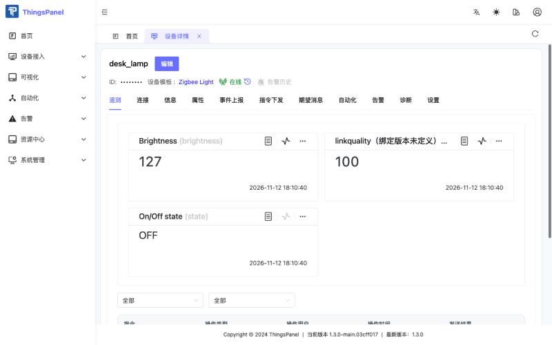

遥测的 key 使用 Z2M 自己的属性名，只展平一层（`color.x` 变成 `color_x`）；丢弃 `update`、`update_available`、`last_seen`；`ON`/`OFF` 保持字符串。

3. 打开**指令下发**标签页，点击**下发命令**，选择命令并填写参数。

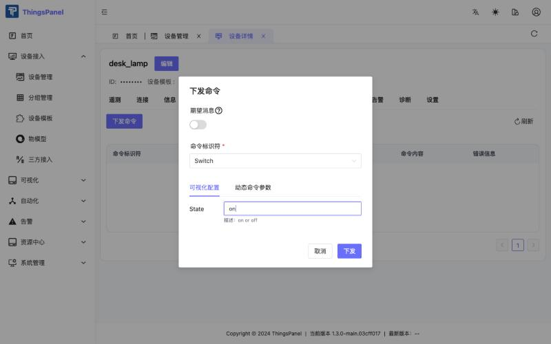

| 命令 | 参数值 | 发给 Z2M 的内容 |
|---|---|---|
| `switch` | `on`、`off`、`true`、`false`、`1`、`0` | `{"state":"ON"}` 或 `{"state":"OFF"}`（设备有多个开关时，用属性名作为命令，如 `state_l2`） |
| `set_brightness`（或 `brightness`） | 1–100（%） | `{"brightness": <0–254>}`；50 % 实际发送 127 |
| 设备 exposes 中任意可写属性 | 值 | `{"<属性>": 值}` |

只有设备的下一次状态与下发值一致，命令才显示为**返回成功**，连接器最多等待 5 秒。对设备没有提供或只读的属性下发命令，会失败并在错误信息列给出原因；会休眠的电池设备可能响应太晚而显示失败。

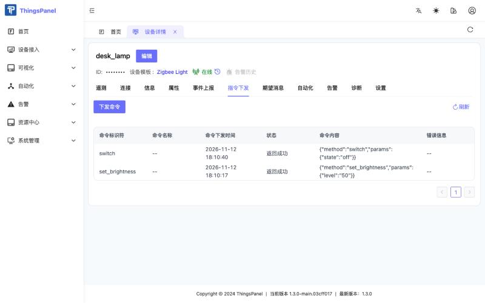

## 10. 已知限制与常见问题

:::note
在只读取新设备接口的 ThingsPanel 前端中，通过三方接入绑定的设备可能不出现在设备列表里。设备本身存在且可用，可从其设备模板的**关联设备**标签页打开。
:::

- **命令在发送前被拒绝。** 设备没有带模板绑定、模板没有绑定已发布的物模型版本，或命令标识符与遥测标识符相同。按第 7 节处理。
- **设备有数据但一直不显示离线。** 在 Z2M 中开启 `availability: true`；不开启时，设备发数据即标记在线，不会变成离线。
- **接入点里没有设备。** Z2M 必须在运行并发布 `bridge/devices`（retained）。检查 Broker 地址、凭证和 base topic；连接器最多等待 3 秒来接收该消息。
- **绑定后设备不上报。** 最多等两分钟；确认设备在绑定后发过数据。
- **在 Z2M 里改名**不会破坏绑定：绑定使用 IEEE 地址。
- **设备很多时。** 每个已绑定设备在 ThingsPanel Broker 上占用一个 MQTT 连接，几百台设备就是几百个连接。
- **设备型号不同。** 命令只接受设备以可写方式暴露的属性；定义命令前，请先在 Z2M 网页界面查看设备的 **Exposes** 标签页。
- 不包含：Zigbee 配对控制（`permit_join`）、OTA 升级、分组和场景，以及自动生成物模型。
