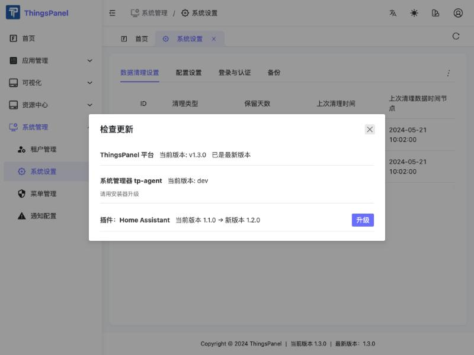

# 系统运维：重启、备份、恢复与升级

> 仅超级管理员（系统管理员）可见。入口在 **系统管理 → 系统设置** 页面。

ThingsPanel 在“系统设置”里提供了一组运维功能，让你不用登录服务器、不用敲命令，就能完成：

- **检查更新**：平台、系统管理器（tp-agent）、已安装插件的新版本，在同一个列表里查看和升级；
- **重启系统**：重启前先检查配置，配置有错就不会重启；
- **备份与恢复**：随时创建备份，也可以把系统恢复到某一份备份；
- **安全升级**：升级前自动备份，新版本起不来时**自动退回**到升级前的版本和数据。

:::info 适用范围
这些功能由安装器部署的“系统管理器”（tp-agent）提供，需要使用官方安装器安装或升级后的环境。手工源码部署的环境没有系统管理器，菜单里的相关操作会提示不可用。
:::

## 入口

打开 **系统管理 → 系统设置**，点击页面右上角的 **⋮** 菜单：

| 菜单项 | 作用 |
|---|---|
| 检查更新 | 列出可用的更新，并可直接升级 |
| 重启系统 | 弹出重启对话框 |

另外，**备份** 在系统设置页的“备份”标签里。

## 检查更新与升级

点击 **检查更新**，列表中会显示三类内容：

| 项目 | 说明 |
|---|---|
| ThingsPanel 平台 | 有新版本时显示新版本号和“升级”按钮；已是最新时显示“已是最新版本” |
| 系统管理器 tp-agent | 只显示版本。它不能在界面里升级，请使用安装器升级 |
| 插件（例如 Home Assistant） | 有新版本时显示“当前版本 → 新版本”和“升级”按钮 |

### 升级平台

1. 点击平台那一行的 **升级**，确认。
2. 系统会**自动先做一份备份**（这一步不能取消）。
3. 页面切换为维护页，显示当前步骤和进度。**请不要关闭页面**，完成后会自动刷新。
4. 升级完成后，页面底部显示新的版本号，你的数据、设备和账号保持不变。

**升级失败怎么办？** 如果新版本迁移失败，或者启动后健康检查不通过，系统会**自动退回**到升级前的版本和数据，并提示“操作失败，系统已自动回退到之前的状态”。你不需要做任何恢复操作。

:::note 需要多长时间
正常升级通常在 1 分钟左右。如果新版本一直不健康，系统最长会等待约 5 分钟再回退，整个过程最长可能接近 7 分钟，请耐心等待。
:::

:::caution 升级期间的数据
升级和回退期间，平台会短暂停止服务，这段时间内设备上报的数据可能丢失。建议在业务低峰期操作。
:::

### 升级插件

点击插件那一行的 **升级**，确认后系统会为插件换上新版本，健康后才把版本记为新版本。插件的站点配置和密钥保持不变。

- 如果新版本的镜像在本机上不存在，系统会直接拒绝升级，正在运行的插件**不受影响**。
- 插件升级失败时，目前**不会**自动退回旧版本，插件会停在失败状态，可以重试升级。

## 重启系统

点击 **⋮ → 重启系统**。打开对话框时，系统会先**检查配置**：

- 检查通过：可以选择重启范围；
- 检查不通过：显示出错的配置项，**重启按钮不可用**，系统不会改动任何东西。

| 重启范围 | 影响 | 耗时 |
|---|---|---|
| **重启平台服务**（推荐，默认） | 只重启平台后端相关服务，**设备保持连接** | 约 40 秒 |
| **全栈重启** | 同时重启消息服务（MQTT Broker），设备会短暂掉线后自动重连 | 约 10 秒掉线，随后重连 |

重启期间页面会显示维护页和进度，完成后自动刷新。

## 备份与恢复

打开 **系统设置 → 备份** 标签：

- **立即备份**：创建一份完整备份。列表会显示时间、版本、大小和触发方式（手动、升级前自动、恢复前自动）；
- 每一行有 **恢复** 和 **删除** 操作。

### 备份里有什么

| 包含 | 不包含 |
|---|---|
| 关系数据库（含时序历史数据） | `.env` 等**密钥文件**、Broker 令牌、私钥和证书、Agent 的密钥库 |
| 上传的文件 | Redis 缓存 |
| 平台的配置文件 | |
| 插件实例清单（ID、版本等，不含密钥） | |

备份保存在**安装目录下的 `backups/` 文件夹**（权限 0700）。系统自动产生的备份（升级前、恢复前）只保留最近 3 份；手动备份不会被自动删除。磁盘可用空间不足预估大小的 2 倍时，系统会拒绝创建备份。

### 恢复

点击某份备份的 **恢复**。系统会：

1. 先给当前状态做一份“恢复前”安全备份；
2. 校验备份包，并检查版本是否兼容；
3. 停止服务、重建数据库、导入备份，再按备份的版本启动；
4. 恢复失败时自动回退到恢复前的状态。

版本规则：

| 情况 | 处理 |
|---|---|
| 备份版本与当前版本相同 | 直接恢复 |
| 备份版本低于当前版本 | 恢复后按迁移向前升级 |
| 备份版本高于当前版本 | **拒绝**，请先把程序升级到不低于备份的版本 |
| 备份校验不通过 | 拒绝 |

## 重要提示

:::warning 请务必阅读
1. **恢复会把数据退回到备份时刻**，备份之后产生的数据（包括设备上报）会丢失。
2. **备份目前只保存在本机，且暂不支持在界面中下载。** 请定期把安装目录下的 `backups/` 复制到其他位置保存。硬盘损坏或更换机器时，只有本机上的备份是不够的。
3. **备份不包含密钥文件**（如 `.env`）。把备份恢复到同一台机器时，这些文件本来就在；要恢复到另一台机器，需要同时保留原机器上的这些文件。
4. 升级、恢复、全栈重启期间设备上报的数据可能丢失。
5. 恢复不会重建插件容器；恢复后如果插件没有恢复上报，请重新安装该插件。
6. 恢复是覆盖式的：上传文件只会被覆盖，备份之后新增的上传文件不会被删除。
:::

## 常见问题

**菜单里没有“检查更新”或“重启系统”？**
这两项只对超级管理员显示。租户用户看不到，直接访问接口会返回 403。

**提示“系统管理器不可用”？**
说明当前环境没有部署 tp-agent（例如手工源码部署）。请使用官方安装器安装或升级。

**升级中途刷新了浏览器？**
没关系，页面会继续显示维护页和进度，完成后自动恢复。

**升级后发现不对劲，能手动回退吗？**
可以：到“备份”标签，选择升级前自动创建的那份备份，点击“恢复”。注意恢复会丢失升级后产生的数据。
