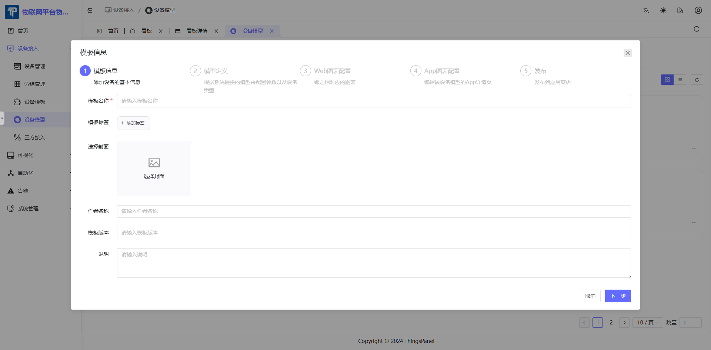
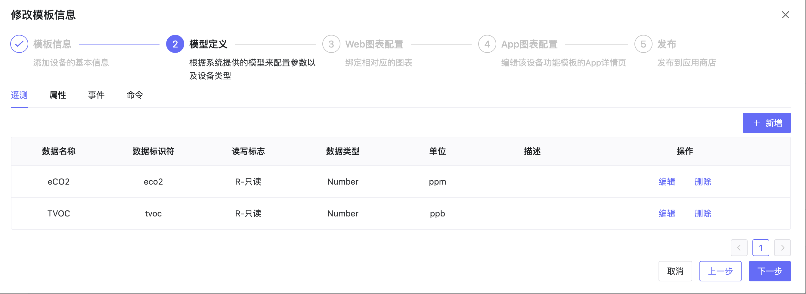
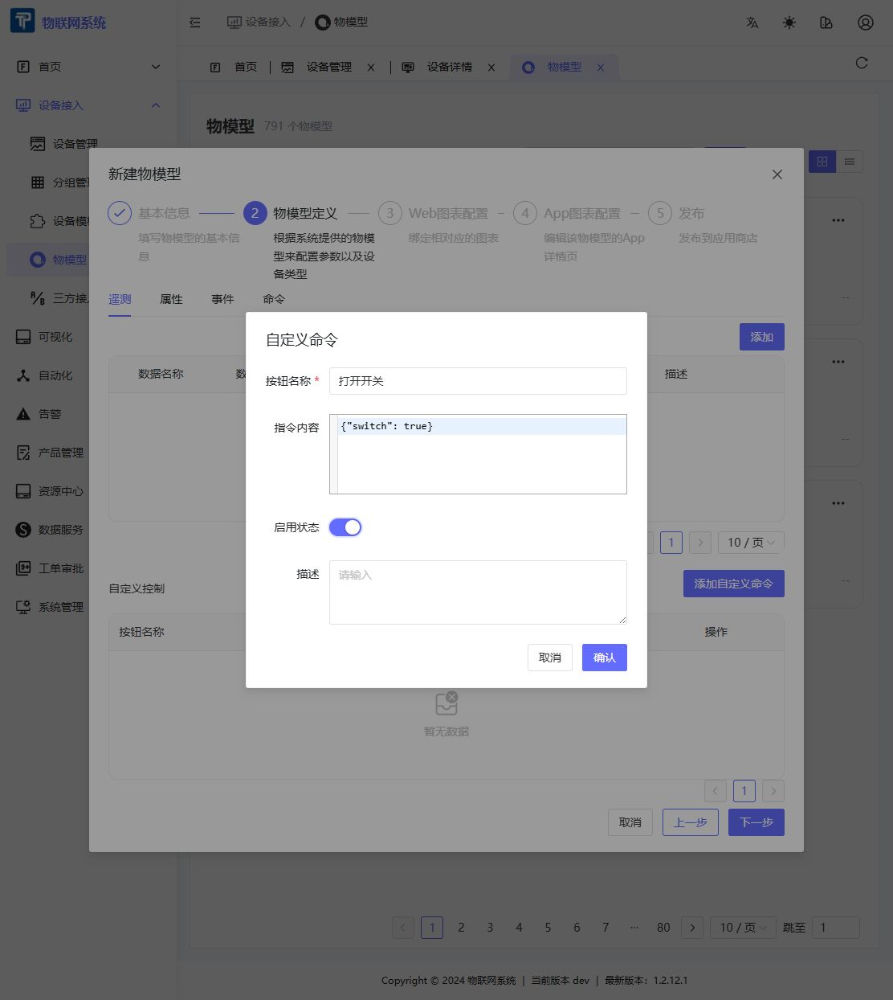
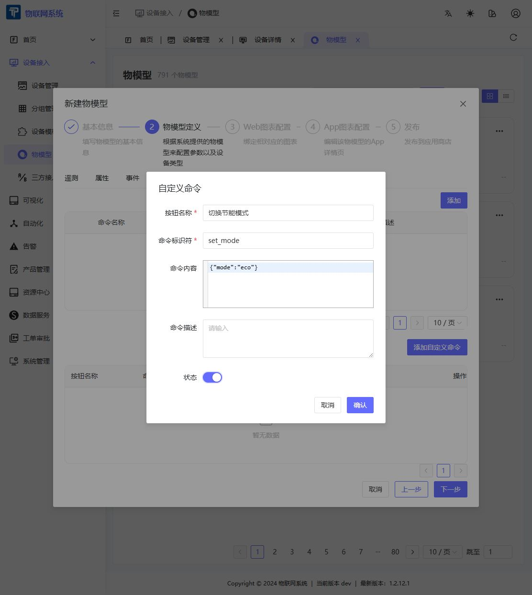
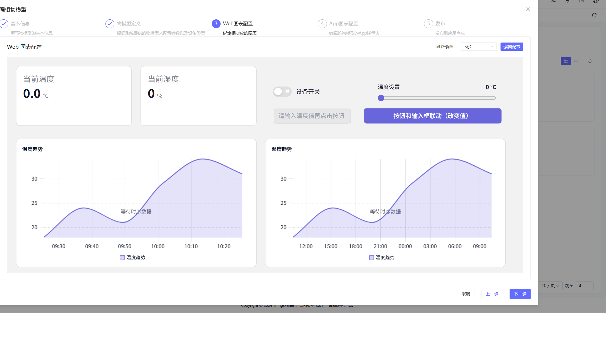
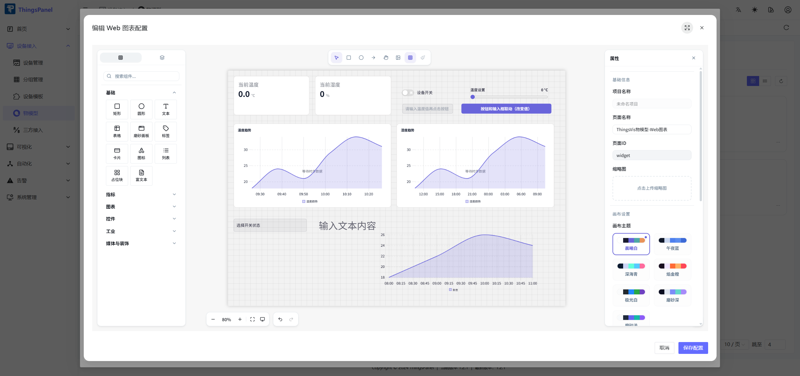
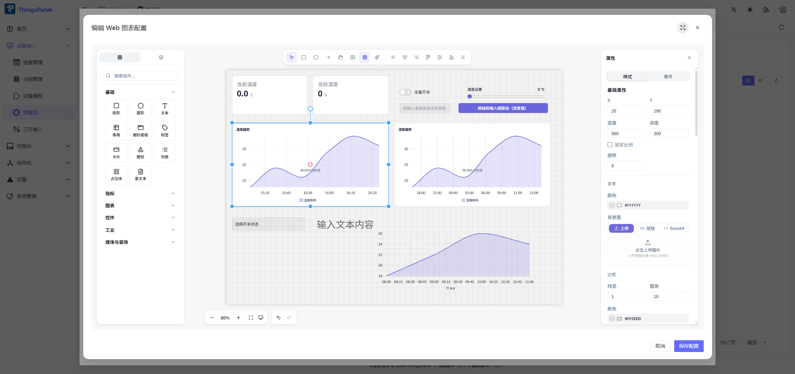
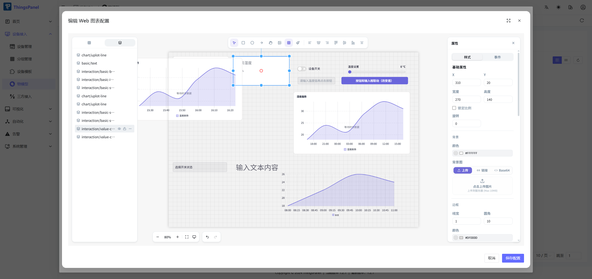
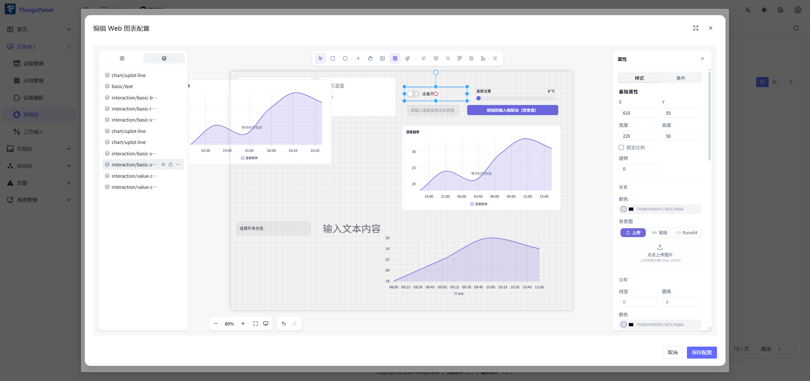

# 物模型

物模型用于定义可复用的设备字段，以及基于这些字段生成的 Web/App 图表页面。设备模板引用物模型后，同一类设备可以复用相同的数据结构和可视化配置。

## 1、说明

- 进入 **设备接入** > **物模型**，打开物模型管理页面。
- 物模型通常对应现实世界中的设备类型，例如温湿度传感器。
- 模型定义包含遥测、属性、事件和命令，这些字段可作为图表配置的数据源。
- 物模型还可以定义自定义按钮，将常用控制内容保存为快捷操作。配置后，按钮会出现在关联设备详情的对应栏目：遥测自定义控制显示在 **遥测** 中，自定义命令显示在 **命令（下发）** 中。
- Web 图表配置和 App 图表配置均通过 ThingsVis 编辑器创建，并支持保存后预览。
- 保存后的图表配置会应用到使用该物模型的设备详情页。

## 2、操作

### 2.1、创建物模型

- 点击 **新建物模型**。
- 填写名称、标签、作者、版本、说明、图标等基本信息。



### 2.2、定义物模型

- 配置遥测、属性的数据名称、标识符、数据类型、单位、说明和读写设置。
- 当设备需要上报事件或接收平台控制指令时，继续配置事件和命令。
- 保存模型定义后，再进入图表配置步骤。



#### 配置自定义按钮 {#custom-buttons}

自定义按钮适合“打开设备”“关闭设备”“设置为节能模式”等内容固定、需要重复执行的操作。管理员在物模型中配置一次后，使用该物模型的设备可以复用这些操作，用户在设备详情中点击按钮即可向当前设备下发预设内容。

| 配置位置（模型定义） | 设备详情中的使用位置 | 适用场景 |
| --- | --- | --- |
| 遥测 → 自定义控制 | 遥测 | 将常用的遥测控制内容保存为快捷操作 |
| 命令 → 添加自定义命令 | 命令（下发） | 将命令标识符及固定参数保存为快捷操作 |

部分版本的入口名称为“新增自定义命令”，设备详情中的命令栏目名称为“指令下发”，对应同一操作位置。

这些按钮由模型定义生成，无需先在 Web 图表编辑器中添加按钮组件。Web 图表中的控制组件属于另一种配置入口。

**配置遥测自定义控制**

1. 进入 **设备接入 → 物模型**，打开需要配置的物模型，进入 **模型定义 → 遥测**。
2. 在 **自定义控制** 区域点击 **添加自定义命令**。
3. 按下表填写配置，打开 **启用状态**，点击 **确认** 保存。

| 配置项 | 填写说明 |
| --- | --- |
| 按钮名称 | 设备详情中展示的名称，建议明确表达动作，例如“打开开关” |
| 指令内容 | 点击按钮时下发的内容，必须是合法 JSON；字段标识符和取值类型应符合设备及接入协议的要求 |
| 启用状态 | 开启后，按钮才会展示在设备详情的遥测栏目中；新增时默认关闭 |
| 描述 | 说明用途、参数含义或适用条件，便于后续维护 |

例如，设备已支持布尔类型的 `switch` 控制字段时，可以创建“打开开关”按钮，指令内容填写：

```json
{"switch": true}
```

再创建“关闭开关”按钮，内容填写 `{"switch": false}`。示例仅用于说明配置方法，请按实际设备协议替换字段和值；创建按钮本身不会让设备自动具备对应的控制能力。

下图展示“打开开关”的配置：填写按钮名称和 JSON 指令，并开启启用状态。保存后，按钮会出现在关联设备详情的 **遥测** 栏目。



**配置自定义命令**

1. 在 **模型定义 → 命令** 中点击 **添加自定义命令**。
2. 填写 **按钮名称**、**命令标识符**、**命令内容** 和 **命令描述**。
3. 将 **状态** 设置为启用，点击 **确认** 保存。

命令标识符用于指定执行哪个命令，应与设备支持的命令一致；命令内容用于填写该命令的参数，格式以接入协议或插件要求为准。不要将按钮名称当作命令标识符。

例如，设备支持命令 `set_mode`，且参数约定为 `{"mode":"eco"}` 时，可将按钮名称设为“切换节能模式”，命令标识符填写 `set_mode`，命令内容填写 `{"mode":"eco"}`。实际使用时请替换为设备支持的命令和参数。

下图展示自定义命令的配置：按钮名称用于显示，命令标识符指定执行的命令，命令内容填写参数。保存并启用后，在关联设备详情的 **命令（下发）/ 指令下发** 栏目使用该按钮。



**在设备详情中使用并验证**

1. 确认目标设备使用的 **设备模板** 已关联该物模型；关联方法见 [设备模板](./device_config.md)。
2. 进入 **设备管理**，打开目标设备详情；若页面已经打开，重新进入对应栏目以加载配置。
3. 遥测控制按钮在 **遥测** 栏目中使用；自定义命令按钮在 **命令（下发）** 栏目中使用。
4. 点击按钮，平台会向当前设备下发预设内容。命令下发后可在该栏目查看状态和错误信息，并结合设备返回或实际状态确认是否执行成功。

:::tip 使用提示
点击自定义按钮会直接触发下发操作，操作前请确认目标设备与按钮含义。平台发送成功与设备执行成功是不同的结果，应以设备返回或实际状态为准。
:::

**常见问题**

| 现象 | 检查方法 |
| --- | --- |
| 在设备详情中找不到按钮 | 检查设备模板关联的物模型是否正确、按钮是否保存，并进入与配置类型对应的栏目；重新打开设备详情加载最新配置 |
| 遥测按钮不显示 | 检查该自定义控制的启用状态，未启用的遥测按钮不展示 |
| 命令按钮显示但不可点击 | 检查自定义命令的状态，禁用的命令按钮不可点击 |
| 遥测控制配置无法保存 | 检查指令内容是否为合法 JSON，例如键名和字符串需使用双引号 |
| 点击按钮后设备未按预期动作 | 检查设备连接、协议或插件配置，以及字段标识符、命令标识符、参数格式和类型；命令下发可结合状态和错误信息排查 |

### 2.3、配置 Web 图表

当前 Web 图表通过内嵌的 ThingsVis 预览和编辑器完成配置。下图以 **物模型配置 DEMO** 为例说明当前流程。

- 在编辑弹窗中进入第 **3 步 Web 图表配置**。
- 在卡片顶部选择刷新频率。DEMO 中当前设置为 **5 秒**。
- 中间区域会以内嵌 ThingsVis 的方式预览当前 Web 图表页面。DEMO 中包含温度趋势、湿度趋势、设备开关、温度设置、当前温度和当前湿度等组件。
- 点击 **编辑配置** 打开 ThingsVis 编辑器。



- 在编辑器中，左侧组件库用于添加组件，中间为画布，右侧属性面板用于配置页面或选中的组件。
- 绑定数据时，从当前物模型字段中选择对应字段，例如 `temperature`、`humidity`、`switch`。
- 点击 **保存配置** 后，页面会保存回 Web 图表配置；如果不保存本次修改，点击 **取消**。
- 保存后会返回 Web 图表预览，确认预览无误后点击 **下一步**。



#### 绑定数据示例

在画布中选中组件，或切换到 **图层** 后按组件名称选择目标组件。选中后，右侧属性面板会显示该组件的数据绑定项。

配置曲线图时，选择 `图表/时序图` 等折线图组件。在 **内容** 中设置标题、图例、X 轴、Y 轴等显示项；在 **数据** 中将数据集绑定模式设为 **字段**，数据范围选择 **设备数据**，数据类型选择 **历史数据**，字段选择 `temperature__history` 或 `humidity__history` 这类历史数组字段。随后按需要设置时间范围、聚合函数、聚合窗口、平滑曲线和面积填充。



配置数值卡片时，选择 `指标/数值`。先设置卡片标题，再将 **数值** 的绑定模式设为 **字段**。数据范围选择 **设备数据**，数据类型选择 **物模型字段**，字段选择 `humidity` 或 `temperature` 等数值字段。根据物模型字段设置单位、是否显示单位、小数位数，也可以按需要开启趋势或图标。



配置开关时，选择 `控制/开关`。将 **开关状态** 的绑定模式设为 **字段**，数据范围选择 **设备数据**，数据类型选择 **物模型字段**，字段绑定到 `switch` 这类布尔字段。然后配置标签文字、标签位置、开启文字、关闭文字、尺寸、颜色，以及禁用、确认后切换等行为选项。



### 2.4、配置 App 图表

App 图表同样使用 ThingsVis 编辑器配置，但会单独保存为移动端 App 详情页配置。

- 进入第 **4 步 App 图表配置**。
- 选择 App 详情页的刷新频率。
- 点击 **创建配置** 或 **编辑配置** 打开编辑器。
- 设计移动端详情页，并将组件绑定到物模型中的遥测或属性字段。
- 点击 **保存配置** 保存 App 图表页面，并返回预览。
- 点击 **下一步** 进入发布步骤。

### 2.5、完成并发布

- 检查物模型基本信息、模型定义、Web 图表配置和 App 图表配置。
- 确认无误后发布物模型。
